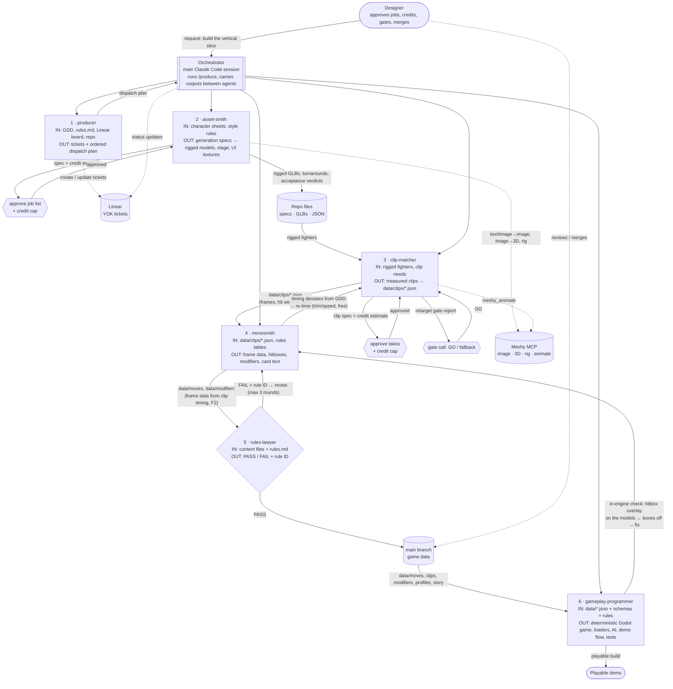
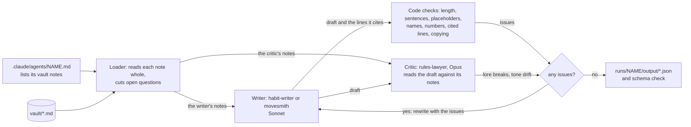
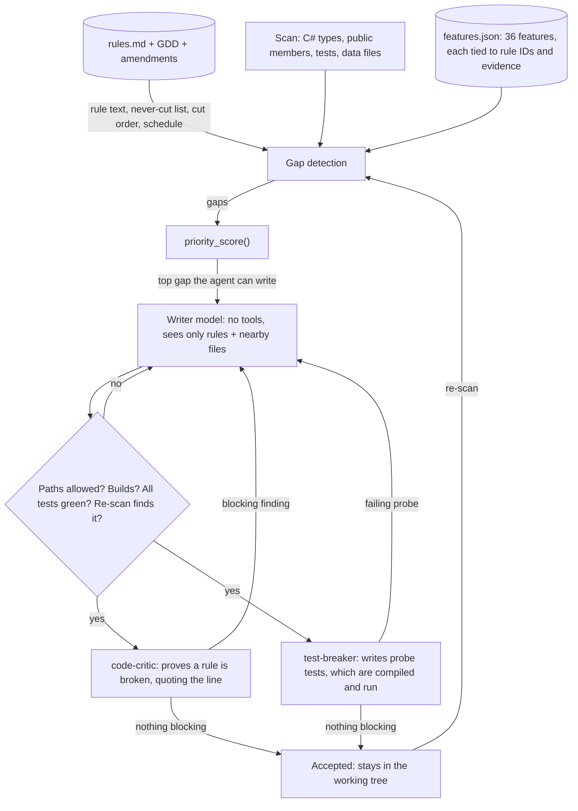
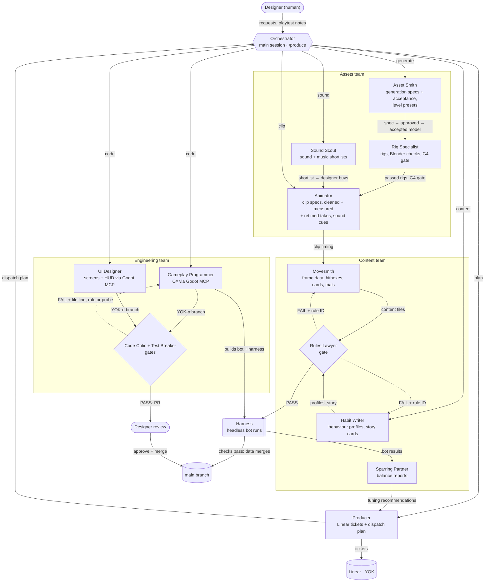

# Yokai Fighters

A single-player **2.5D roguelite fighting game** for PC, built in **Godot 4 (.NET) with C#** as a 5-week capstone.

You play Ryo, an apprentice exorcist who binds yokai instead of destroying them, apologising to each one he seals into a talisman. Every yokai he beats lends him one of three abilities, so the yokai you choose to fight decide the fighter you become. At the end of every run waits the Tanuki, a shapeshifter that copies the move you have invested in most.

> **Assignments:** each write-up is a section of this README.
> - Assignment 3 (Build an Agent Crew): [Assignment 3: Agent crew](#assignment-3-agent-crew)
> - Assignment 4 (Dynamic Content Pipeline): [Assignment 4: Dynamic content pipeline](#assignment-4-dynamic-content-pipeline)
> - Assignment 5 (Goal-Oriented Coding Agent): [Assignment 5: Goal-oriented coding agent](#assignment-5-goal-oriented-coding-agent)

## The game at a glance

| | |
|---|---|
| **Run** | 8-row map, one node per row: 6 one-round duels (two against elders) and 2 rest stops, then the Tanuki. 25–40 minutes. |
| **Duel** | 60 fps, deterministic, one round. Ryo's 1,000 health carries across the run. |
| **Reward** | After each win, draft 1 of 3 abilities from the yokai you beat. Specials level up and evolve at Lv 3. |
| **Yokai** | Kitsune (zoner), Oni (rushdown), Kappa (grappler), each with two temperaments, one punishable habit and an elder twist. |
| **Boss** | The Tanuki copies your highest-level special at your level, but never your modifiers or evolution. |
| **Controls** | Kata (motion inputs, +10% precision bonus) or Kihon (one Special button). |
| **Between runs** | Unlocks by depth reached; your best special carries over at Lv 2. |

### Design pillars
1. Every upgrade changes how you fight.
2. Your fighter is yours.
3. Every choice costs something.
4. Easy to start, deep to master.
5. The game answers your habits.
6. Readable, fair fights.

## Getting started

You need Godot 4.7 (.NET; CI uses 4.7.2) and the .NET 10 SDK. Python 3.10+ runs the tools in `tools/`.

```
cd game
dotnet build
godot --headless --path . --import                         # once per fresh checkout
godot --path .                                             # play (or open game/project.godot and press F5)
godot --headless --path . res://tests/test_runner.tscn     # the full test suite; `-- only=<Class>` runs one class
godot --headless --path . res://tests/run_harness.tscn     # the whole-run bot harness (200 runs, seed 1)
```

From the repo root, the content and docs checks:

```
pip install -r tools/requirements.txt                     # once: jsonschema for the validator
python -I tools/validate_data.py                           # data/ against data/schema/
python -I tools/check_rules.py                             # the written rules over all content
python tools/data_merge_check.py --base origin/main        # the full data merge check (docs/process/data-merge-check.md)
python -I tools/check_docs.py                              # dead links and stray Markdown
```

## Repository map

| Path | What it holds |
|---|---|
| `game/` | The Godot project: `scripts/` by system (`Sim/` is the pure-C# deterministic fight core; `Ai/`, `Fight/`, `Flow/`, `Ui/`, `Harness/`, `SaveGame/`, …), `scenes/`, `tests/` (the headless suite, `probes/` from Test Breaker, `fixtures/`) and `assets/generated/` |
| `data/` | Game content as JSON (moves, modifiers, cancels, trials, profiles, story, map, clips, sound) and its JSON Schemas in `data/schema/` |
| `docs/` | Design, process and history. **[`docs/README.md`](docs/README.md) indexes every document** |
| `assets/` | Generation specs and acceptance results (`specs/`), sound shortlists (`shortlists/`) |
| `harness/` | Whole-run bot results and balance reports |
| `tools/` | Content validators, the data merge check, Blender scripts, the content pipeline and the goal agent |
| `vault/` | The design as linked notes for the content agents |
| `.claude/`, `.codex/`, `.agents/` | The agent crew's definitions (`.claude/` is the source; the other two are generated by `tools/sync_codex.py`) |

## Documents

| File | What it is |
|---|---|
| [`docs/README.md`](docs/README.md) | **Index of every document**, with its owner |
| [`Yokai_Fighters_GDD_Extended.pdf`](Yokai_Fighters_GDD_Extended.pdf) | Full game design document, the source of truth |
| [`Yokai_Fighters_GDD_Short.pdf`](Yokai_Fighters_GDD_Short.pdf) | 5-page readable summary |
| [`docs/design/gdd-amendments.md`](docs/design/gdd-amendments.md) | Approved changes to the GDD; an amendment wins over the PDF section it names |
| [`docs/design/rules.md`](docs/design/rules.md) | The GDD's rules and numbers with citable IDs (`C4`, `T2`, `A8`…) |
| [`docs/decision-log.md`](docs/decision-log.md) | What was decided, one line per decision |
| [`CHANGELOG.md`](CHANGELOG.md) | Every merged PR by build week |
| [`docs/process/change-tracking.md`](docs/process/change-tracking.md) | Where each kind of change is recorded |
| [`vault/`](vault/Home.md) | The design as linked notes, one topic per note, for people and for the agents |
| [`tools/content_pipeline/`](tools/content_pipeline/) | Drafts card text from the vault: writer agents read whole notes, and a critic checks each draft against the vault |
| [`tools/goal_agent/`](tools/goal_agent/) | Goal-oriented coding agent: reads the rules, scans the code, ranks what is missing and writes the top gap through build, test and critic gates |
| [`docs/crew/vertical-slice-run-log.md`](docs/crew/vertical-slice-run-log.md) | The crew's run that built the Ryo vs Kitsune vertical slice, step by step |
| [`docs/agent-crew.html`](docs/agent-crew.html) | Interactive map of the agent crew (open in a browser) |
| [`CLAUDE.md`](CLAUDE.md) | Working instructions for Claude Code and the crew |

## Assignment 3: Agent crew

The crew turns a character design into **game-ready fighting content**. Its outputs:
- rigged 3D fighters and stage assets generated through the Meshy MCP
- measured animation clips
- frame data and hitboxes derived from those clips
- reward modifiers and card text

Every piece passes a written-rules gate before it reaches the game. In this run it produced the assets and content for the game's first vertical slice, **Ryo vs the Kitsune in the bamboo grove at dusk**. That covers both fighters, nine tails, the stage props and backdrop, 41 measured clips (re-timed onto the GDD's frame targets), frame data and hitboxes for every move of both fighters, and two reward modifiers. All of it runs in a playable demo (see [Demo: the vertical slice](#demo-the-vertical-slice)).

A fighting game is unforgiving here. A move's frame data has to match what the animation shows, frame by frame, or the game feels wrong. So the crew is built around one rule, **clip first (F2)**: no frame data is written until the clip it describes has been generated *and measured*.

| Where to look | Section |
|---|---|
| The six agents, with input, output and why each is needed | [The crew (6 agents)](#the-crew-6-agents) |
| How they connect, and where the designer approves | [Architecture](#architecture) |
| A real run, with its pull requests, task ids and credits | [Does it run?](#does-it-run) |
| The playable result | [Demo: the vertical slice](#demo-the-vertical-slice) |

### The crew (6 agents)

All six are Claude Code subagents, and their definitions are the ones the project runs, in [`.claude/agents/`](.claude/agents/): [producer](.claude/agents/producer.md), [asset-smith](.claude/agents/asset-smith.md), clip-matcher, [movesmith](.claude/agents/movesmith.md), [rules-lawyer](.claude/agents/rules-lawyer.md) and [gameplay-programmer](.claude/agents/gameplay-programmer.md). The orchestration procedure is [`.claude/skills/produce/SKILL.md`](.claude/skills/produce/SKILL.md), and the Meshy MCP config (no key) is [`.mcp.example.json`](.mcp.example.json).

Since this assignment, clip-matcher has been split in two (amendment AM5): [rig-specialist](.claude/agents/rig-specialist.md) now owns the rigs and the retarget gate, and [animator](.claude/agents/animator.md) owns the clips. This section describes the crew as it ran for the vertical slice. The current crew is in [The agent crew](#the-agent-crew).

| # | Agent | Role | Input | Output | Why it can't be removed |
|---|---|---|---|---|---|
| 1 | **producer** | Lead: turns the goal into tickets and a dispatch order | GDD, `rules.md`, Linear board, repo state | Linear tickets (goal, acceptance criteria, agent, rules) and an ordered dispatch plan with designer approvals listed | Without it nothing is sequenced. Dependencies like "rig before clips, clips before frame data" and the credit approvals are never identified |
| 2 | **asset-smith** | Generates and accepts visual assets | Character sheets, style rules, approved job list | Generation specs with credit estimates, then rigged GLB fighters, stage props, UI textures and acceptance verdicts | Without it there are no rigged models, so clip-matcher has nothing to animate |
| 3 | **clip-matcher** | Picks, generates and *measures* each move's animation | Rig task ids, clip-needs list, approved take list | Clip specs, the retarget go/no-go report, and `data/clips/*.json` with real frame counts and hit windows | Without it movesmith has no timing to derive from, and rule F2 forbids frame data without a measured clip |
| 4 | **movesmith** | Designs moves from the clip timing | `data/clips/*.json`, rules tables | `data/moves/*.json` (startup/active/recovery, 2D hitboxes, damage, EX, levels), `data/modifiers/*.json`, card text | Without it the clips never become playable moves or rewards |
| 5 | **rules-lawyer** | Gate: read-only judge against the written rules | Content files + `docs/design/rules.md` | `PASS`, or `FAIL` with the exact rule ID and fix | Without it content merges unchecked. Wrong sources, broken numbers or paired throws would reach the game |
| 6 | **gameplay-programmer** | Builds the Godot (.NET/C#) game that plays the content, and checks it in the engine | `data/` (moves, clips, modifiers, profiles, story) + schemas + rules | The deterministic fight engine, data loaders and schemas, AI, reward draft, demo flow, the models stepped frame by frame from the clips, the hitbox overlay, and 245 automated tests | Without it the content never becomes a game. Its in-engine checks (overlay, model probes) also found bugs the files alone couldn't show, and each went back to the author agent |

A human designer sits at approval gates between the agents (hexagons in the diagram). No Meshy credit is spent without their approval, and a failed gate goes back to the author agent.

### Architecture

Solid arrows are data flow (files the next agent reads). Dotted arrows are tool calls. Hexagons are designer approval gates: no Meshy credit is spent and no content merges without one.



**Coordination:** Claude Code subagents can't call each other. The main session is the orchestrator. It runs the `produce` procedure: start the producer, then dispatch each ticket through its workflow (generate → clip → content → gate). It passes each agent's output files and report on to the next agent. Agents run in parallel where tickets don't depend on each other, each in its own git worktree and branch, and every result lands as a pull request.

### Does it run?

Yes, and on real work. [`docs/crew/vertical-slice-run-log.md`](docs/crew/vertical-slice-run-log.md) traces one full run on 5–6 October 2026: producer → asset-smith → clip-matcher → movesmith → rules-lawyer. It lists the pull request, the Meshy task ids and the credits for each step. In that run:
- 500 Meshy credits were spent, all inside approved caps.
- 41 clips were measured.
- Movesmith wrote frame data for both fighters. It flagged that the clips ran long, so clip-matcher re-timed them. Movesmith then re-derived the data, and every normal now matches the GDD table.
- Once the models were in the game, movesmith re-placed all 34 moves' hitboxes on the bodies.
- The rules-lawyer passed four content PRs (#37, #38, #39, #48), and each merged into the game's `data/`.
- gameplay-programmer built the game that loads all of it, across 22 PRs from an empty project to a playable demo, with tests growing from 12 to 245.

The outputs are in the project itself, where the game and the next agent read them:

| Stage | Agent | Where it is |
|---|---|---|
| References | asset-smith | The chosen stylised references: [Ryo E](docs/design/characters/ryo/references/ryo-ref-e.png), [Kitsune D](docs/design/characters/kitsune/references/kitsune-ref-d.png) |
| Models and stage | asset-smith | The approved job list [`assets/specs/jobs/yok-29-job-list.md`](assets/specs/jobs/yok-29-job-list.md); turnarounds and rigged models in [`game/assets/generated/characters/`](game/assets/generated/characters/); the [stage backdrop](game/assets/generated/stage/bamboo-grove/backdrop.png) |
| Retarget gate | clip-matcher | The gate report [`assets/specs/clips/retarget_gate.md`](assets/specs/clips/retarget_gate.md) and its measured stills (the [Kitsune's sleeve flare](assets/specs/clips/stills/retarget-gate/kitsune-heavy.png); the [shove substituted for the failed grab](assets/specs/clips/stills/retarget-gate/ryo-grab-2.png)) |
| Clips | clip-matcher | [`data/clips/`](data/clips/), which movesmith reads, e.g. [`ryo-light-punch.json`](data/clips/ryo-light-punch.json) and [`kitsune-foxfire.json`](data/clips/kitsune-foxfire.json); stills in [`assets/specs/clips/stills/`](assets/specs/clips/stills/) |
| Reward content | movesmith | Modifier files that passed rules-lawyer: [`will-o-wisp.json`](data/modifiers/will-o-wisp.json), [`fox-patience.json`](data/modifiers/fox-patience.json) |
| Frame data | movesmith | [`data/moves/`](data/moves/), derived from the re-timed clips: [Ryo's light punch](data/moves/ryo-light-punch.json) (4/2/7 = C8), the [heavy kick](data/moves/ryo-heavy-kick.json), the shared [Foxfire](data/moves/foxfire.json) |
| Hitbox alignment | movesmith → rules-lawyer | [`docs/screenshots/review/YOK-33-hitbox-alignment/`](docs/screenshots/review/YOK-33-hitbox-alignment/), before and after: Ryo's heavy-kick and air-kick hitboxes moved from floating above the limb onto the foot |

Failure handling also ran:
- Three library grabs failed measurement, so clip-matcher applied the F5 substitute.
- Six clips were proposed for retake rather than forced.
- Movesmith flagged clip timings that disagreed with the GDD instead of hiding them. That loop (movesmith → clip-matcher re-time → movesmith) brought every normal onto target.
- Movesmith also found an engine bug, which became its own ticket.

### Demo: the vertical slice

The crew's output is playable. The demo is Ryo vs the Kitsune in the bamboo grove at dusk. It uses the rigged models, measured clips, frame data and hitboxes this crew produced, plus the two reward modifiers:

1. **Start screen** with the controls ([screenshot](docs/screenshots/current/start.png)).
2. **The fight** on Kihon controls against the AI Kitsune. She has one readable habit: she jumps right after getting up ([screenshot](docs/screenshots/current/stage/fight.png)).
3. **F1 hitbox overlay:** the boxes from movesmith's data drawn on the moving models ([screenshot](docs/screenshots/current/fighters/ryo-heavy-kick-active.png)).
4. **Win:** the binding line, *"Forgive me, Kitsune. I'll set your spirit free."*, then three reward cards. Foxfire is NEW, a Lv 2 upgrade is UPGRADE, and Will-o'-wisp or Fox's Patience is MODIFIER ([screenshot](docs/screenshots/current/reward_binding.png), [screenshot](docs/screenshots/current/reward_cards.png)).
5. **Rematch** with the drafted power and the carried health, then the demo-complete card ([screenshot](docs/screenshots/current/demo_complete.png)).

**Play it on Windows, no install needed:**
1. Download [`YokaiFighters-Demo-Windows.zip`](https://github.com/Andreas203/yokai-fighters/releases/download/demo-v0.1/YokaiFighters-Demo-Windows.zip) from the [`demo-v0.1` release](https://github.com/Andreas203/yokai-fighters/releases/tag/demo-v0.1) (145 MB).
2. Right-click the zip and choose **Extract All**. Don't run the game from inside the zip.
3. Open the `YokaiFighters-Demo` folder and double-click **`PLAY.bat`**. It checks that the folder is complete, then starts the game. The start screen lists the keyboard and gamepad controls.

To run it from source instead, install Godot 4.7 (.NET) and the .NET 10 SDK, then:
```
git clone https://github.com/Andreas203/yokai-fighters.git
cd yokai-fighters/game
dotnet build
godot --headless --path . --import   # first run only
godot --path .                        # or open game/project.godot in the editor and press F5
```

Agents 1–5 produced what the game *plays*: the models, clips, frame data, hitboxes and reward content. **gameplay-programmer** (agent 6) built the game that plays it, from the deterministic 60-tick fight engine to the demo flow; its work is listed in the [run log](docs/crew/vertical-slice-run-log.md), § 6. The HUD and menu screens came from a separate `ui-designer` agent, which isn't part of this crew.

## Assignment 4: Dynamic content pipeline

The pipeline generates card text for this game from its own design documents. Two crew agents write and a third checks. Each agent reads whole Markdown notes from my design vault, the writer drafts a card and names the lines it used, and the critic reads the draft against the vault and sends it back until it passes. There is no vector database, no index and no search step: the agents just read Markdown files. It wrote **ten pieces across three content types** the game is missing.

| Where to look | Section |
|---|---|
| The knowledge base is my GDD | [The source](#the-source-my-gdd-as-a-vault) |
| The three content types and the gap each fills | [The gap and the outputs](#the-gap-and-the-outputs) |
| The agents and the vault notes each one reads | [The agents and the notes they read](#the-agents-and-the-notes-they-read) |
| The pipeline and how to run it | [How the pipeline works](#how-the-pipeline-works), [Run it](#run-it) |
| Notes loaded, line cited and output side by side | [Notes loaded, line cited, output](#notes-loaded-line-cited-output) |
| A lore break and a tone drift caught and corrected | [What the critic caught](#what-the-critic-caught) |
| Self-assessment and the change that improved game-fit | [Do the outputs sound like my game?](#do-the-outputs-sound-like-my-game) |

### The source: my GDD as a vault

The knowledge base is [`vault/`](vault/Home.md): 13 Markdown notes distilled from [`Yokai_Fighters_GDD_Extended.pdf`](Yokai_Fighters_GDD_Extended.pdf) and its approved amendments (Linear tickets YOK-1 to YOK-5). It has vision, vibe (tone, story, characters, art and audio) and mechanics (combat, controls, abilities, run loop, yokai, Tanuki, economy, meta-progression). Every number is copied from the GDD, and each note lists the GDD sections it comes from.

The vault is small, about 42 KB in all, so an agent can read the notes it needs from top to bottom. Open questions are kept at the bottom of each note and are cut before an agent reads it, so the model is not handed undecided design as fact.

### The agents and the notes they read

Three crew agents take part. Each one's definition file has a "Vault notes" section that lists the notes it reads, and the pipeline loads exactly that list. The same list tells the agent what to read when it runs in Claude Code through `/produce`.

| Agent | Role here | Notes it loads whole | Size |
|---|---|---|---|
| [`habit-writer`](.claude/agents/habit-writer.md) | Writes wake-up cards and elder intro cards | [Tone](vault/01-vibe/Tone.md), [Story](vault/01-vibe/Story.md), [Characters](vault/01-vibe/Characters.md), [Yokai](vault/02-mechanics/Yokai.md) | 15,628 characters |
| [`movesmith`](.claude/agents/movesmith.md) | Writes modifier reward card text | [Tone](vault/01-vibe/Tone.md), [Abilities](vault/02-mechanics/Abilities.md), [Characters](vault/01-vibe/Characters.md) | 13,501 characters |
| [`rules-lawyer`](.claude/agents/rules-lawyer.md) | Critic: checks every draft | [Tone](vault/01-vibe/Tone.md), [Story](vault/01-vibe/Story.md), [Characters](vault/01-vibe/Characters.md), [Yokai](vault/02-mechanics/Yokai.md), [Abilities](vault/02-mechanics/Abilities.md) | 20,919 characters |

### The gap and the outputs

My game is thin on written text. Three kinds of card the design calls for are missing or only part written. The pipeline wrote ten pieces to fill them, every one generated from the vault files the writing agent loaded. Each part below names the gap, where it shows in the repo, and the text that fills it.

#### 1. Wake-up cards

**The gap.** After a loss the GDD asks for "wake-up variants by row reached and by which yokai won" (rule S3 in [`docs/design/rules.md`](docs/design/rules.md)). The game varies the card by row only: [`lose-early.json`](data/story/lose-early.json), [`lose-mid.json`](data/story/lose-mid.json) and [`lose-late.json`](data/story/lose-late.json) in `data/story/` are each written to fit any yokai. No card is about the yokai that won, and none says whether a talisman carries over.

**The outputs.** Three cards, each for one yokai at one depth, written by `habit-writer`.

| Loss | Card | File |
|---|---|---|
| Oni, rows 2–3 | "{yokai} shoulders its iron club and heads back toward the snowy shrine gate without a word. You wake at the province's edge, and every talisman is blank." | [`wake-up-oni-early.json`](tools/content_pipeline/runs/whole-notes/output/wake-up-card/wake-up-oni-early.json) |
| Nine-Tailed Kitsune, row 5 | "{yokai} wanders off through the bamboo at dusk, unhurried, one tail trailing like a sleeve. You wake at the province's edge, and every talisman is blank." | [`wake-up-nine-tails-row-5.json`](tools/content_pipeline/runs/whole-notes/output/wake-up-card/wake-up-nine-tails-row-5.json) |
| Kappa, row 6 | "{yokai} bows politely, spilling a little water from its dish, and goes back to the lantern riverbank. Ryo wakes at the province's edge, and one paper talisman still bears a faint stroke of ink." | [`wake-up-kappa-row-6.json`](tools/content_pipeline/runs/whole-notes/output/wake-up-card/wake-up-kappa-row-6.json) |

Each card places the yokai on its own stage (the Oni's snowy shrine gate, the Kitsune's bamboo, the Kappa's lantern riverbank). The row decides the talisman line: a loss at row 5 or earlier leaves every talisman blank, and a loss at row 6 leaves one faintly inked.

#### 2. Elder intro cards

**The gap.** Each elder adds one rule twist, and the twist must show as "a map-node icon, a one-line intro card, and a callout on first meeting" (rule Y3). [`data/story/`](data/story/) holds no elder intro card.

**The outputs.** One card for each of the three elders, written by `habit-writer`.

| Elder and twist | Card | File |
|---|---|---|
| Nine-Tailed Kitsune: reflects a special used twice in a row | "Nine tails sway in the lantern light, and a trick shown to her twice in a row is handed straight back." | [`elder-intro-nine-tailed-kitsune.json`](tools/content_pipeline/runs/whole-notes/output/elder-intro-card/elder-intro-nine-tailed-kitsune.json) |
| Elder Oni: armour on every special | "Snow drifts past the shrine gate as blows land on the Elder Oni, and its iron club swings on through without a flinch." | [`elder-intro-elder-oni.json`](tools/content_pipeline/runs/whole-notes/output/elder-intro-card/elder-intro-elder-oni.json) |
| Elder Kappa: throws can't be broken | "The Elder Kappa bows politely at the lantern riverbank, and once its hands close on you, no struggle will pry them loose." | [`elder-intro-elder-kappa.json`](tools/content_pipeline/runs/whole-notes/output/elder-intro-card/elder-intro-elder-kappa.json) |

Each card shows the twist as something the player would see, so they can work out the rule before the fight.

#### 3. Reward card text for modifiers

**The gap.** The game ships 14 modifiers (rule A11) and each reward card needs two lines: plain language first, with the frame data behind a toggle (rule A12). [`data/modifiers/`](data/modifiers/) holds two, both from the Kitsune: [`fox-patience.json`](data/modifiers/fox-patience.json) and [`will-o-wisp.json`](data/modifiers/will-o-wisp.json). The Oni and the Kappa have no card text.

**The outputs.** Four cards, written by `movesmith`: the Oni and Kappa modifiers that start unlocked. With the two Kitsune cards they make up the six that stay even if the balance gate cuts modifiers from 14 to 8 (rule G3).

| Modifier | plain | frames |
|---|---|---|
| [Oni's Hide](tools/content_pipeline/runs/whole-notes/output/modifier-card/onis-hide-card.json) | "Thick oni hide: the special you attach this to can't be interrupted early on." | "Armour on frames 1–5" |
| [Iron Will](tools/content_pipeline/runs/whole-notes/output/modifier-card/iron-will-card.json) | "Proud as an oni with an iron club, this special can't be interrupted by projectiles." | "Can't be interrupted by projectiles" |
| [Slippery Skin](tools/content_pipeline/runs/whole-notes/output/modifier-card/slippery-skin-card.json) | "Slick as a riverbank stone, your special can't be thrown while it's starting up." | "Throw-invulnerable during startup" |
| [River Pull](tools/content_pipeline/runs/whole-notes/output/modifier-card/river-pull-card.json) | "The river tugs at your foe: when the special it's attached to hits, the opponent is pulled one step closer." | "Pulls the opponent one step closer on hit" |

#### The shape of an output

Every output is a JSON file in the game's own data shape. This is the Kappa wake-up card, [`wake-up-kappa-row-6.json`](tools/content_pipeline/runs/whole-notes/output/wake-up-card/wake-up-kappa-row-6.json):

```json
{
  "kind": "story_card",
  "id": "wake-up-kappa-row-6",
  "status": "proposed",
  "trigger": "Later loss: Ryo is knocked out by the Kappa at row 6 (wake-up variant by row reached and winning yokai, S3)",
  "text": "{yokai} bows politely, spilling a little water from its dish, and goes back to the lantern riverbank. Ryo wakes at the province's edge, and one paper talisman still bears a faint stroke of ink.",
  "placeholders": [
    "yokai"
  ],
  "speaker": "narrator",
  "rules": [
    "S1",
    "S2",
    "S3",
    "S4",
    "M3"
  ],
  "notes": "Generated by tools/content_pipeline (run whole-notes): written by habit-writer from vault notes 01-vibe/Tone.md; 01-vibe/Story.md; 01-vibe/Characters.md; 02-mechanics/Yokai.md; checked by rules-lawyer"
}
```

The model wrote the `text`. Code added the id, trigger and rule list, and `notes` records which agent wrote the card and the vault notes it read. The six story cards pass the repo's schema validator ([`tools/validate_data.py`](tools/validate_data.py)). All ten are marked `proposed` and stay in the run folder: they go through my approval before anything merges into `data/`.

### How the pipeline works



- **Loading** ([`vault.py`](tools/content_pipeline/vault.py)): reads the note list from the agent's file and loads each note complete, minus its "Open questions" section. There is no chunking, index or query.
- **Writing** ([`content.py`](tools/content_pipeline/content.py)): the prompt carries only the output contract (length, placeholders, JSON shape) and the notes. The model is told it knows nothing about the game except those notes. It runs with every tool off in an empty folder, so it cannot read the rest of the repo. With the text it returns one to four `sources`: the lines of the notes the text rests on, copied word for word.
- **Consistency check** ([`critic.py`](tools/content_pipeline/critic.py)): code checks for what needs no judgment, and a critic model that must quote a vault line for every issue. One code check confirms each cited line is in a note the writer loaded. Another stops the writer copying a run of eight or more words from a note.
- **Loop** ([`run.py`](tools/content_pipeline/run.py)): issues go back to the writer, for up to three drafts. Ids, triggers and rule lists are added by code, never by the model.

The pipeline takes each agent's note list from its definition file. It does not run the rest of that agent's instructions: the writer and the critic get a short role prompt, the output contract and the notes.

#### Run it

From the repo root:

```
python tools/content_pipeline/run.py generate --replay         # rebuild the recorded run, no model calls, no login
python tools/content_pipeline/run.py critic-test --replay      # the seeded-fault test
python tools/content_pipeline/run.py notes                     # which agent loads which notes

python tools/content_pipeline/run.py generate                  # live: needs the `claude` CLI, logged in
```

Python 3.10+, standard library only. The schema check on the story cards is the one optional extra: it needs `pip install -r tools/requirements.txt` (`jsonschema`), and without it a replay keeps the check the run recorded. Each run writes `runs/<name>/trace.md` in [`tools/content_pipeline/`](tools/content_pipeline/), with the notes loaded, the lines cited, every draft and every critic issue, plus `llm-calls.json`, which `--replay` reads back.

| Run | What it is | Result |
|---|---|---|
| [`whole-notes`](tools/content_pipeline/runs/whole-notes/trace.md) | The ten pieces above; its [`output/`](tools/content_pipeline/runs/whole-notes/output/) holds them | 10/10 passed, 3 after correction |
| [`critic-seeded-faults`](tools/content_pipeline/runs/critic-seeded-faults/trace.md) | Three hand-broken drafts fed to the critic | 3/3 caught and corrected |
| [`archive-chunked/`](tools/content_pipeline/runs/archive-chunked/) | Two runs from the earlier design that chunked the vault and searched it. Traces and outputs only; they cannot be replayed with the current code | kept for the comparison below |

### Notes loaded, line cited, output

One example per content type, from the `whole-notes` run. The cited lines are the writer's own `sources`, and code confirmed each one is in the note word for word. The full tables for all ten pieces are in the trace.

| Notes the writer loaded | Line it cited | Output |
|---|---|---|
| Tone.md, Story.md, Characters.md, Yokai.md | **01-vibe/Story.md**: "A wake-up card after a run that reached row 6 or further may say one talisman stays faintly inked."<br>**01-vibe/Characters.md**: "Folklore reference: kappa are river spirits that love sumo and cucumbers and carry water in a dish on their heads; bow to one and it bows back, spilling the water." | Kappa, row 6: "{yokai} bows politely, spilling a little water from its dish, and goes back to the lantern riverbank. Ryo wakes at the province's edge, and one paper talisman still bears a faint stroke of ink." |
| Tone.md, Story.md, Characters.md, Yokai.md | **02-mechanics/Yokai.md**: "Elder twist \| Armour on every special"<br>**02-mechanics/Yokai.md**: "Habit the twist breaks \| Mashing jabs to interrupt it stops working"<br>**01-vibe/Characters.md**: "The rushdown yokai of the snowbound mountain shrine gate." | "Snow drifts past the shrine gate as blows land on the Elder Oni, and its iron club swings on through without a flinch." |
| Tone.md, Abilities.md, Characters.md | **02-mechanics/Abilities.md**: "River Pull \| Pulls the opponent one step closer on hit \| no" | plain: "The river tugs at your foe: when the special it's attached to hits, the opponent is pulled one step closer." <br>frames: "Pulls the opponent one step closer on hit" |

The first row shows a vault fact deciding the output. The Kappa card keeps one talisman inked because the note says a run that reached row 6 may. The Oni card, for a loss at rows 2–3, cited a different line of the same note (**01-vibe/Story.md**: "A wake-up card after a run that ended at row 5 or earlier says the talismans are blank.") and says "every talisman is blank". The bow that spills water from the Kappa's dish comes straight from the folklore line in the Characters note.

### What the critic caught

#### In the real run

**Tone drift, corrected (Elder Oni intro card).**

| | |
|---|---|
| Draft | "Snow gathers on the shrine gate as the Elder Oni swings its iron club, and no jab ever turns a special aside." |
| Critic (tone_drift) | "The card states the armour rule in game-system terms ("jab", "special") instead of showing what a person standing at the shrine gate would see." |
| Evidence it quoted | `Tone.md#Card form`: "A card does not explain a rule in system words… it says what a person standing there would see." |
| Rewrite, passed | "Snow drifts past the shrine gate as blows land on the Elder Oni, and its iron club swings on through without a flinch." |

**A copied example, corrected (Nine-Tailed Kitsune wake-up card).** The draft opened "{yokai} slips off between the lanterns, tails swaying, and does not look back." That is the existing lose-screen card, which the Story note quotes. The copy check flagged 13 words in a row taken from `Story.md`. The rewrite: "{yokai} wanders off through the bamboo at dusk, unhurried, one tail trailing like a sleeve. You wake at the province's edge, and every talisman is blank."

**A copied sample line, corrected (Kappa wake-up card).** The draft ended "You wake at the province's edge; your talismans are blank, all but one, faintly inked." The first 13 words are the GDD's own first-loss sample, also quoted in the Story note. The copy check flagged it, and the rewrite is the card in the table above.

The critic model passed both copied drafts, because a copied line contradicts nothing in the vault. That is why the copy check is code and not a judgment call.

#### Seeded faults

The real drafts did not break lore outright, so I also wrote three broken drafts by hand and gave them to the same loop ([`seeded_faults.json`](tools/content_pipeline/seeded_faults.json)). These are tests of the critic, not generated content.

| Seeded draft | What the critic caught | Corrected to |
|---|---|---|
| Oni wake-up card: "{yokai} brings the club down until the snow runs red, and laughs over what is left of you. You wake screaming at the province's edge, your talismans blank, all but one." | 5 issues. Tone drift: gore, and "wake screaming" (`Tone.md#The tone line`: "nothing is gory, cruel, demonic or frightening"). Lore break: the yokai gloats (`Story.md#Wake-up cards`). Lore break: "all but one" after a row 2–3 loss (`Story.md#Talismans`: "A run that ended at row 5 or earlier leaves every talisman blank"). A second round then tripped the copy check. | "Snow drifts through the lantern light as {yokai} shoulders its iron club and heads back up to the shrine gate. Ryo stirs at the edge of the province, every talisman blank." |
| Elder Oni intro: "No guard in the province has ever stopped the Elder Oni's club, so do not try to block it." | 2 lore breaks: the twist is armour on every special, not an unblockable club (`Yokai.md#Oni`), and the card teaches the wrong lesson, since the twist breaks mashing jabs, not blocking. | "Quick jabs patter off the Elder Oni's hide, and its iron club keeps swinging straight through them." |
| Oni's Hide card: "shrugs off every blow for the whole move and hits harder too" / "Armour on frames 1-12, +10% damage" | 5 issues. Code: 12 and 10 are not in the ability table row for Oni's Hide. Critic, 3 lore breaks: armour for the whole move, an invented damage bonus, and the wrong frame line, each against the table row "Oni's Hide: Armour on frames 1–5". | "The oni's hide toughens the start of this move: it can't be interrupted early on." / "Armour on frames 1–5" |

#### What it missed

- **Nine-Tailed Kitsune wake-up card:** "one tail trailing like a sleeve". This is the nine-tailed elder, so one tail reads oddly. The critic passed it. I would change it to "her tails" before this merges.
- **Kappa wake-up card:** the rewrite says "Ryo wakes", where the GDD's sample wake-up card says "You wake" and the other two cards follow it. The writer changed person to get past the copy check. Whether every wake-up card uses "you" is an open question in the Tone note, and open questions are not loaded, so the critic had no line to cite.
- **The copy check is blunt.** In the seeded Oni run it flagged "You wake at the province's edge, your talismans", which is a stock opening, not a lifted example. That cost a third draft and pushed the writer to "Ryo stirs".

### Do the outputs sound like my game?

Mostly yes, with two that need a hand edit.

- **Wake-up cards** are the closest. They keep the tone line (a yokai that wins walks away; the cost is half spoken) and each uses its yokai's own stage and manner. The Oni leaving "without a word" and the Kappa bowing and spilling a little water are the lonely-spirit register I want. The Kitsune and Kappa cards carry the two nits listed above.
- **Elder intro cards** are the best result. Each teaches its twist as something seen, not as a rule, and a player can still work the twist out. The Nine-Tailed Kitsune card keeps "twice in a row", which is close to the rule's own words; I would accept it because the player needs that cue.
- **Modifier cards** are usable and the plainest. The folklore openers ("Slick as a riverbank stone", "The river tugs at your foe") match the two cards already in the game. Oni's Hide now says "can't be interrupted early on", the wording of the GDD's own card mockup, which the writer found in the Abilities note and cited.

#### The change that made the difference: from search to whole notes

My first build treated the vault as a search problem. It split the notes into 83 sections, ranked them with BM25 and gave the writer the top four for **one query per piece**. For "Wake-up story card shown after Ryo loses a duel to the Oni at row 2 or 3" it returned three sections that share the word "card", no tone section, nothing about the Oni and not the talisman rule. For the Elder Kappa it returned the **Oni's** section. The text was accurate but read like a tooltip.

A second version gave each piece a hand-written query plan, one narrow query per thing the text needed, each limited to one note, with the tone sections always included. That fixed the output, but I was now choosing the notes by hand and running a search on top.

The final version drops the search. Each agent's file lists the notes it reads and it reads them whole. A vault of 13 notes fits in a prompt many times over, nothing the text needs can be missed by a bad query, and a new piece needs no query plan. The writer prompt's contract did not change.

| Piece | First build: one search query | Now: the agent reads whole notes |
|---|---|---|
| Elder Oni intro | "The Elder Oni shrugs off every blow with armour on all its specials, so mashing jabs to interrupt it will get you flattened." | "Snow drifts past the shrine gate as blows land on the Elder Oni, and its iron club swings on through without a flinch." |
| Oni wake-up | "Ryo wakes at the province's edge, every talisman blank. Whatever {yokai} wanted, it has already gone back to its own business, leaving him only the dust and the walk back." | "{yokai} shoulders its iron club and heads back toward the snowy shrine gate without a word. You wake at the province's edge, and every talisman is blank." |
| River Pull frames | "Modifier on one special: on hit, pulls opponent one step closer. Kappa. Unlocked." | "Pulls the opponent one step closer on hit" |

The earlier traces are kept in [`archive-chunked/`](tools/content_pipeline/runs/archive-chunked/).

Whole notes brought one new problem, and it needed a second change. With every quoted example in view, the writer lifted two of them almost whole, and the critic passed both. I added the copy check described above and ran the ten pieces again: both cards were rewritten in new words.

A smaller choice sits in the vault itself: I wrote the tone note as quoted do-and-don't lines with a reason each, not as adjectives, so that the writer has lines to imitate and the critic has lines to cite.

### Where everything lives

| Path | What it is |
|---|---|
| [`vault/`](vault/Home.md) | The knowledge base |
| [`.claude/agents/`](.claude/agents/) | The agent definitions; `habit-writer`, `movesmith` and `rules-lawyer` each list their vault notes |
| [`tools/content_pipeline/run.py`](tools/content_pipeline/run.py) | The CLI: `generate`, `critic-test`, `notes`, `--replay` |
| [`tools/content_pipeline/vault.py`](tools/content_pipeline/vault.py) | Reads an agent's note list and loads each note whole |
| [`tools/content_pipeline/content.py`](tools/content_pipeline/content.py) | The three content types, the agent that writes each, and the writer prompts |
| [`tools/content_pipeline/critic.py`](tools/content_pipeline/critic.py) | Code checks and the critic model |
| [`tools/content_pipeline/llm.py`](tools/content_pipeline/llm.py) | Model calls through the `claude` CLI, recorded for replay |
| [`tools/content_pipeline/seeded_faults.json`](tools/content_pipeline/seeded_faults.json) | The three hand-broken drafts |
| [`tools/content_pipeline/runs/`](tools/content_pipeline/runs/) | The recorded runs: `trace.md`, `trace.json`, `llm-calls.json` and each run's output |

## Assignment 5: Goal-oriented coding agent

The agent's goal is one sentence: **every feature the design requires is in the codebase.** It reads the design, scans the code, finds what is missing, decides what to build next, writes it, and scans again until nothing it can write is left. It chose and wrote the rule the whole game is built around, the Tanuki's copy target. That code passed the game's test runner, merged in PR #89 exactly as the agent wrote it, and is what the Tanuki fight, the HUD and the save system now call.

Everything in [`tools/goal_agent/`](tools/goal_agent/) was written for this game.

| What the assignment asks for | Section |
|---|---|
| Source code: reads the GDD, scans the codebase, generates code | [How the agent works](#how-the-agent-works), [Run the agent](#run-the-agent) |
| Priority scoring | [`priority_score()`](#priority_score) |
| Gap-detection pass, code-writing step, iteration loop | [How the agent works](#how-the-agent-works) |
| The feature the agent built | [What the agent built](#what-the-agent-built) |
| Why it selected that feature | [Why the agent chose it](#why-the-agent-chose-it) |
| Manual changes before accepting the code | [Manual changes before accepting the code](#manual-changes-before-accepting-the-code) |

### The deliverables

| Deliverable | Where |
|---|---|
| Source code | [`tools/goal_agent/`](tools/goal_agent/): about 1,450 lines of Python, standard library only, plus 22 unit tests |
| Working feature | [`game/scripts/Sim/Run/CopyRule.cs`](game/scripts/Sim/Run/CopyRule.cs), the changes to [`RunState.cs`](game/scripts/Sim/Run/RunState.cs), and [`game/tests/Sim/Run/CopyRuleTests.cs`](game/tests/Sim/Run/CopyRuleTests.cs) |
| Feature documentation | this section |

### How the agent works



| Part | File | What it does |
|---|---|---|
| Reads the GDD | [`gdd.py`](tools/goal_agent/gdd.py) | Parses every rule in [`docs/design/rules.md`](docs/design/rules.md) (my GDD distilled into citable IDs), the GDD transcription by section, and the amendments. From section G it reads what is never cut (G1), what is cut first (G2, G3) and which week each milestone belongs to (G5). |
| Scans the codebase | [`scan.py`](tools/goal_agent/scan.py) `scan()` | Walks `game/scripts`, `game/tests` and `data`: every C# type, public member and `[Test]`, every data file. |
| **Gap-detection pass** | [`scan.py`](tools/goal_agent/scan.py) `detect_gaps()` | Checks each feature's evidence against the scan: present, partial or missing. Comments are stripped first, so `// copy rule not built here` cannot make the copy rule look built. |
| **Priority scoring** | [`priority.py`](tools/goal_agent/priority.py) `priority_score()` | One number per gap, with the reason for every point. See below. |
| **Code-writing step** | [`writer.py`](tools/goal_agent/writer.py) | Prompts a model with the rule text and the files next to the feature, parses its answer and writes it. It may only create or edit the files the feature names, can never edit an existing test, and every write is snapshotted so a rejected attempt is undone completely. |
| Verifying what it wrote | [`verify.py`](tools/goal_agent/verify.py) | `dotnet build`, then the game's headless test runner inside Godot. |
| Adversarial critics | [`critics.py`](tools/goal_agent/critics.py) | See [The adversaries](#the-adversaries). |
| **Iteration loop** | [`run.py`](tools/goal_agent/run.py) `cmd_build()` | Scan, detect, rank, write the top gap, then scan again from scratch. Stops when nothing is missing, when nothing that is left can be written by the agent, or when the run's budget is spent, and says which. |

#### What "required" means

[`features.json`](tools/goal_agent/features.json) is the bridge between the design and the code: 36 features, each with the rule IDs it implements and the evidence that proves it exists (a type, a test class, a count of data files). I wrote it by hand, and the agent holds it to the design: it refuses to run if a feature cites a rule that is not in `rules.md`, names a milestone the schedule does not use, points at the full-game stretch section, or if any rule is covered by no feature and not explicitly listed as untracked. Priority is not stored in that file at all.

#### `priority_score()`

Ranking a gap takes two steps.

**Step 1: can the agent write it right now?** A gap is skipped if any of these is true:
- **It is blocked:** something it needs is not built yet. The Tanuki fight, for example, needs the copy target first.
- **It is not code:** moves and card text go to Movesmith or the Habit Writer.
- **It has no build brief yet** in `features.json`.

Skipped gaps still get a score, but they are listed after every gap the agent can write, and the report names who they go to. That is why a gap the agent can write at 9 points sits above a content gap at 20.

**Step 2: score it.** Points are added up from six questions. Every answer is read from the design (section G of `rules.md`) or from the scan, so if I edit rule G1, the ranking changes with no change to the tool.

| Question | Points |
|---|---|
| Does G1 say it's never cut? | **+40** |
| How soon is it due (G5)? | **+30** if due this week or late, +20 next week, +10 the week after, 0 later |
| How many unbuilt features are waiting on it? | **+6 each**, counting at most 5 (so +30 max). This includes indirect waits: if A waits on B and B waits on this one, both count. |
| Is it on the cut list if the build falls behind (G2, G3)? | The earlier it gets cut, the bigger the penalty: Kata −20, meta-unlocks −16, modifiers −12, dojo trials −8, presets −4 |
| How big is it? | **−5** per size point (sizes 1 to 3) |
| Is it already half-built? | **+5** |

The agent writes the eligible gap with the highest total. In one line: build what can never be cut first, then whatever is due, then whatever unlocks the most other work, and leave anything that might be cut until last. The worked scores for the recorded run are in [Why the agent chose it](#why-the-agent-chose-it).

#### The adversaries

A writer that grades its own work will pass it. So after the mechanical gates (allowed paths, build, every existing test, the re-scan), two critics with the opposite incentive get the change:

- **code-critic** is told to assume the code is wrong and prove it against the rule text. A finding only counts if the line it quotes is really in the file and the rule it cites is really in `rules.md`; anything else is thrown away and logged. This stops a critic inventing problems.
- **test-breaker** does not argue. It writes up to eight probe tests whose expected values come from the rules, and the agent compiles and runs them in the game's test runner. A probe that fails is the finding. A probe that does not compile is discarded.

A blocking finding removes the attempt from the repo and goes back to the writer with the critic's reasoning. The writer may dispute a probe by naming the rule ID; disputed probes are not argued further, they are listed for me to decide. Advisory findings never block: they are the suggested changes in the final report.

Before the model critics run, plain code checks reject what is never acceptable here: Godot types, floats, clocks or unseeded randomness in simulation code, yokai or ability ids hard-coded in shipping code, tests that read `data/` instead of fixtures.

#### Run the agent

From the repo root:

```
python tools/goal_agent/run.py gaps                         # what is missing, ranked, with reasons. No model calls.
python tools/goal_agent/run.py gaps --json                  # the same, for the producer agent
python tools/goal_agent/run.py build --run NAME             # write the top-ranked gap, re-scan, stop
python tools/goal_agent/run.py build --run NAME --max-features 3
python tools/goal_agent/run.py critic-test                  # seed faults into accepted code, see who catches them
python -m unittest discover -s tools/goal_agent -p "test_*.py"
```

`gaps` needs only Python 3.10+. `build` also needs the `claude` CLI (logged in), `dotnet` and `godot` on PATH, and a branch other than `main`: the agent writes to the working tree and never commits, pushes or merges. Each run writes `runs/<name>/trace.md` with every decision, plus `llm-calls.json` with every prompt and reply.

#### How it connects to Linear

The agent never touches Linear. It reads the design, scans the code and writes to the working tree, nothing else. The `producer` agent keeps the board in step with it on every `/produce` pass:

1. It runs `run.py gaps --json`.
2. Every gap with no ticket gets one, in score order. The gap's owner is the agent assigned, its unmet evidence is the acceptance criteria, and its rule IDs go on the ticket.
3. A gap's `blocked_by` list becomes Linear blocking relations between the tickets.
4. A ticket whose feature the scan now reports present is ready to close.

A ticket for a gap the agent can write may be run by the agent instead of a crew programmer: `run.py build --only <feature-id>` on the ticket's `YOK-<number>` branch, with the trace in the PR description. The PR then goes to my review like any other.

The recorded `copy-target` run came before this wiring: it ran on the `YOK-assignment-5-goal-agent` branch with no ticket, so that feature never had a Linear ticket.

### What the agent built

**The Tanuki's copy target** (rules T2, T3, T4; GDD 5.3). Recorded run: [`runs/v1-copy-target/trace.md`](tools/goal_agent/runs/v1-copy-target/trace.md).

The Tanuki boss copies one of Ryo's specials. Until then nothing in the game could say which one. The agent wrote:

- `CopyRule.Target(RunState)`: the highest-level special in a slot (T2), ties to the one levelled most recently, then the lower slot (T3).
- `CopyTarget.Build()`: the copy's move at Ryo's level, never with his modifier and never with the Lv 3 evolution (T4), so an evolved move always beats its copy.
- In `RunState`: the run did not record when a special gained a level, which T3 needs. The agent added it, put it in the run's state hash only for runs where something has levelled (so existing hashes hold), and added a way to restore it for the later save system.
- 17 tests, one per clause of the rules.

**It runs.** The game's headless test runner went from 363 passing tests to 380, with none failing:

```
cd game && dotnet build
godot --headless --path . res://tests/test_runner.tscn     # ... TESTS 380 passed, 0 failed
```

When the agent wrote it, it was simulation code with no screen of its own. It is now the copy rule the game plays by: the crew built the rest of the chain on top of `CopyRule.Target`, unchanged. The Tanuki's kit takes its copied special from it ([`TanukiKit.cs`](game/scripts/Sim/TanukiKit.cs), built from [`NodeFight.cs`](game/scripts/Sim/Run/NodeFight.cs)), the HUD talisman that glows for the copy target reads it ([`HudRunView.cs`](game/scripts/Fight/HudRunView.cs)), and the save system checks a restored run against it ([`SaveData.cs`](game/scripts/SaveGame/SaveData.cs)).

### Why the agent chose it

It was not told to. On the first scan it found 15 of 36 features present and ranked the 21 gaps; five were ones it could write at that moment:

| Rank | Feature | Score |
|---|---|---|
| 1 | `copy-target` (T2, T3, T4) | 95 |
| 2 | `merchant-heal` (R6) | 83 |
| 3 | `dojo-rest` (R7) | 43 |
| 4 | `coins` (R8) | 37 |
| 5 | `unlocks` (M1) | 9 |

The score for `copy-target`, as the agent printed it:

| Factor | Points | Why |
|---|---|---|
| never cut | +40 | G1 lists "copy rule" |
| schedule | +30 | G5 puts "copy rule" in week 2; now week 2: due this week or late |
| unblocks | +30 | 7 unbuilt features wait on it: copy-lock, copy-target-hud, merchant-shop, rest-stop-screen, tanuki-fighter, tanuki-pressure, whole-run-harness |
| size | −5 | size 1 of 3 |
| **total** | **95** | |

The merchant's heal is also never cut and also due this week. The copy target won on one thing: seven other gaps cannot start without it, including the Tanuki fight itself and the harness. `unlocks` came last because G2 names the meta-unlock layer as the second thing cut if the build falls behind.

After the write, the agent scanned again: 16 present, `copy-target` gone from the list, and `copy-lock` (T1), blocked a moment earlier, now ranked first at 83. It stopped there because the run's budget was one feature.

**The same scan today.** Run on the repo as it is now (build week 3), `gaps` finds 33 of 36 features present; the crew built the rest of them through tickets. The one gap left that the agent can write is `unlocks` (M1), at 9 points: due, but the second thing G2 cuts. The other two go to their owners: the remaining abilities to Movesmith, hit feedback to the Gameplay Programmer.

### What the critics did to it

The feature took three attempts. The first two built, passed every test and passed all eight probes, and were still rejected:

| Attempt | Mechanical gates | code-critic | test-breaker | Result |
|---|---|---|---|---|
| 1 | build ok, 375 tests green | The level-up order decides the copy target but is not in `StateHash()`: two runs with the same hash get different copy targets, and a restored run can silently change its target. | 8 probes, 0 failed | rejected |
| 2 | build ok, 379 green | The new restore method stores any positive number: restore `int.MaxValue`, level another special, and the order wraps negative, so the wrong special wins the T3 tie. | 8 probes, 0 failed | rejected |
| 3 | build ok, 380 green | 4 advisory findings, none blocking | 7 probes, 0 failed | **accepted** |

Every finding the critic made across the run quoted a real line and a real rule; none had to be thrown away. Nine model calls in total.

#### Do the critics work, or do they just complain?

A critic that always finds something proves nothing. So [`seeded_faults.json`](tools/goal_agent/seeded_faults.json) holds three faults I wrote by hand, each one line that breaks a rule in the accepted code. `critic-test` puts each one in, runs the gates as in a real attempt, and takes it out again. The critics see the whole files with no hint of where the fault is. Recorded run: [`runs/critic-seeded-faults/trace.md`](tools/goal_agent/runs/critic-seeded-faults/trace.md).

| Seeded fault | Rule | My agent's own tests | code-critic | test-breaker |
|---|---|---|---|---|
| Ties go to the least recently levelled special instead of the most recent | T3 | 7 fail | found it: "The tie-break is inverted", `CopyRule.cs:55` | 5 probes fail |
| The copy of a Lv 3 special keeps Ryo's evolution | T4 | 1 fails | found it: the constant "never clamps", `CopyRule.cs:35` | 1 probe fails |
| A full tie goes to the higher slot instead of the lower | T3 | 2 fail | found it: "the HIGHER slot wins", `CopyRule.cs:54` | 3 probes fail |

All three were caught three ways, and each critic finding named the seeded line itself rather than something nearby. With no fault seeded, the same critics passed the same code with nothing blocking, so they tell broken code from working code. Six model calls.

### Manual changes before accepting the code

**To the generated game code: none.** `CopyRule.cs`, the `RunState.cs` changes and `CopyRuleTests.cs` merged in PR #89 exactly as the agent's third attempt wrote them, and `CopyRule.cs` and `CopyRuleTests.cs` have not been edited since. The three attempts were corrected by the agent's own critics, not by me. The two `.cs.uid` files beside the new scripts were generated by Godot's import step, not by the agent.

**Conditions for accepting the feature: two, both mine.** PR #89 had to merge first, because the HUD that puts the copy target on screen is built on `CopyRule.Target`. Once it was on screen, playing it showed me two things the rules had not asked for. I did not count the feature as accepted until both were fixed. Neither change touched the agent's code. Both were in the HUD the crew built on top of it:

- **The copy target showed in every fight.** The HUD talisman followed rule T6 as it was written then: "visible all run". In a yokai or elder fight that reads as if the Tanuki's copy were in play, and it is not. I changed the design (amendment [AM6](docs/design/gdd-amendments.md), rule T6) so the fight HUD shows the copy target only in the Tanuki's fight. The map and the rest-stop forecast still show it all run (YOK-118).
- **The copy reminder stayed up for the whole fight.** The strip that says what the Tanuki copies covered part of the screen for the entire Tanuki fight. I had it shown for the first 10 seconds (600 ticks) of each fight, then fade out (YOK-121, [`FightHud.cs`](game/scripts/Fight/FightHud.cs)).

The agent got the rule right. What it could not judge was how the rule should look in play. That took me playing it.

**To the agent's inputs, before the run:** the first version of the feature's brief allowed the writer only `CopyRule.cs` and its test file. T3's "most recently levelled" cannot be answered without the run recording level-ups, so I added `RunState.cs` to the files the feature may edit. That is the one place where I had to understand the feature better than the agent's manifest did.

**What I reviewed and accepted as it is.** The writer flagged two readings where the rules are silent, which only I could decide. I kept both:

- T3 counts a gained level as "levelled". A newly drafted Lv 1 special has not levelled, so a run where everything is Lv 1 resolves to the lower slot (Spirit Wave), not to the newest pick.
- T4 says the copy never has the evolution. The writer read that as: a copy of a Lv 3 special runs the Lv 2 numbers.

**Suggested changes I have not taken yet.** The critics left four advisory findings that did not block acceptance. They are still open:

1. `CopyRuleTests.cs:325`: one assertion takes its "before" hash too early, so it cannot fail for the reason it names. Take the hash after the Foxfire equip. This one is simply right.
2. `CopyRuleTests.cs`: T2 says "throws included" and no test uses a throw special. Add one.
3. `CopyRule.cs:25`: `CopyTarget.Build` always uses the default sim config while Ryo's move uses the match's. Pass the config through if a match ever runs on a non-default config.
4. `RunState.cs`: the level-up order is hashed for every run with a level-up, even where it cannot change the result. Either narrow it or accept that recorded hashes of such runs change. No recorded replay was affected when it merged (all 380 tests passed, including the replay tests).

### Which existing agents became goal-oriented

My crew had ten agents when I built this. I went through each and asked one question: can it measure for itself whether it is finished, and is it safe for it to keep going until it is? (clip-matcher has since been split into `rig-specialist` and `animator`; the answer for both is the one clip-matcher got.)

| Agent | Goal-oriented now? | Why |
|---|---|---|
| `producer` | **Yes** | It planned by reading the ticket board, which only shows work someone already thought of. It now starts every pass with `run.py gaps --json` and tickets the gaps in score order. Its pass is done when every gap is ticketed, blocked with a reason, or waiting on me. How the gaps become tickets: [How it connects to Linear](#how-it-connects-to-linear). |
| `gameplay-programmer` | **Yes** | It already looped on build and tests. It now has a stated goal and stop condition: the gap its ticket names is reported present by the scan, not "the code is written". |
| `ui-designer` | No, but it gets the critics | Whether a screen is finished is a visual judgment against the concept art, and that is mine. A loop cannot check it. |
| `movesmith`, `habit-writer` | No | Their counts are easy to measure (33 abilities, 7 profiles) and the gap report now shows them, but every move waits on a clip I have approved. A loop would stall on me or write frame data with no clip, which rule F2 forbids. |
| `asset-smith`, `rig-specialist`, `animator`, `sound-scout` | No | Each step spends generation credits or money. An agent that pursues a goal by spending is the one I least want looping unattended. |
| `rules-lawyer` | No, deliberately | It is a gate. A gate with a goal of its own, such as "get content merged", is biased toward passing. Its job is to have no stake in the outcome. |
| `sparring-partner` | No | It reads results and recommends. If it could change the numbers to hit its own targets, it would be marking its own homework. |

Two new agents, both adversarial, both for code, which had no gate before (content has had the Rules Lawyer since assignment 3):

- [`code-critic`](.claude/agents/code-critic.md): reads a code branch against the written rules and rejects by file, line and rule ID. Read-only.
- [`test-breaker`](.claude/agents/test-breaker.md): writes probe tests that try to make a branch give a wrong answer and reports the ones that fail. It can write probes and nothing else.

The goal agent's in-loop critics take their briefs from these two role files ("What to attack"), so the tool and the crew attack the same things and I maintain one description. `/produce` now runs both on every code branch before it reaches my review queue, with three rounds before a ticket is marked blocked, the same shape as the Rules Lawyer gate for content.

### What I would change next

- The manifest is hand-written. The agent checks it against the design in both directions, but a feature I forgot to describe is still a feature it cannot see beyond "rule X is covered by nothing".
- The writer sees only the files a brief names. That kept it honest and cheap here, and it is why the brief needed `RunState.cs` added by hand.
- The critic in attempt 2 blocked on an input (`int.MaxValue` from a save file) that no code produced at the time. It was right, and the fix was small, but a critic with no cost for blocking will always find one more edge. The cap of four attempts is the only thing that bounds it today.
- The recorded run had a budget of one feature, so the loop's re-scan is shown once. A longer run would show it carrying on to `copy-lock`.

## The agent crew

The game is built with a crew of AI agents running in Claude Code. They are **development tools only**; none of them ship in the game. A human designer reviews their work, runs the asset generators, buys sound, makes cut decisions and approves every code merge.

| Team | Agent | Responsibility |
|---|---|---|
| Lead | `producer` | Turns outstanding work into Linear tickets and a dispatch plan |
| Assets | `asset-smith` | Writes generation specs for models, stages and textures (Tripo or Meshy), runs approved jobs and checks the results; level presets |
| Assets | `rig-specialist` | Rigs every fighter (generator auto-rig or AccuRIG 2), checks it in Blender, keeps it on the shared skeleton, runs the G4 gate |
| Assets | `animator` | Specs each move's clip (generator, motion capture or bought pack), cleans, measures and retimes the take, then frame-timed sound |
| Assets | `sound-scout` | Shortlists sound-effect and music packs for the designer to buy |
| Content | `movesmith` | Writes frame data from the matched clip, hitboxes, card text and dojo trials |
| Content | `habit-writer` | Writes yokai behaviour profiles and all story-card text |
| Content | `rules-lawyer` | Gate: rejects content that breaks the written rules, citing the rule |
| Content | `sparring-partner` | Reads whole-run bot results and recommends minimal tuning |
| Engineering | `gameplay-programmer` | C# systems, fight AI, test bot and harness via the Godot MCP |
| Engineering | `ui-designer` | Every screen and the HUD via the Godot MCP |
| Engineering | `code-critic` | Gate: assumes a code branch is wrong and tries to prove it against the written rules; read-only |
| Engineering | `test-breaker` | Gate: writes probe tests that try to break a code branch |

Agent definitions live in [`.claude/agents/`](.claude/agents/). Run a production pass with **`/produce`** ([`.claude/skills/produce/SKILL.md`](.claude/skills/produce/SKILL.md)).

### How the agents work together

Subagents in Claude Code can't call each other directly. The main Claude Code session is the orchestrator: it runs the Producer, then carries each ticket from agent to agent along one of its workflows. Agents communicate through files in the repo (clip matches, content data, harness results), Linear tickets and pull requests.



**The workflows**

| Workflow | Path | Ends when |
|---|---|---|
| **content** | Animator (if a clip is needed: see **clip**) → Movesmith or Habit Writer → Rules Lawyer → harness checks | Schema, Rules Lawyer and harness pass, then the data merges. Three failed gate rounds block the ticket for the designer. |
| **generate** | Asset Smith spec → designer approves job and cost → job runs (Meshy MCP, or the designer in Tripo) → acceptance check | Accepted, or 3 takes then a fallback |
| **rig** | Rig Specialist spec → designer approves the job (generator auto-rig or AccuRIG 2) → job runs → Blender checks → G4 gate for a yokai | Rig accepted, or 3 takes then a fallback |
| **clip** | Animator spec → designer approves the take → take runs (generator, motion capture or bought pack) → Animator cleans, measures and retimes it | A measured clip in `data/clips/`, or an F5 substitute after 3 takes |
| **sound** | Sound Scout → designer buys → Animator sound cues | The designer has made the purchase decision |
| **code** | Gameplay Programmer or UI Designer on its own branch, build-and-test loop via the Godot MCP → Code Critic → Test Breaker | The designer approves the PR. Agents never merge. Three failed gate rounds block the ticket for the designer. |
| **balance** | Harness results → Sparring Partner → Producer tickets the tuning | Tuning tickets re-enter the content workflow |

## Tickets, branches and PRs

- Tickets live in **Linear**, team `Yokai-fighters` (key `YOK`), grouped under Epics A–F.
- Branch names and PR titles are both `YOK-<number>-<brief-name>`, e.g. `YOK-19-generic-throws`.
- Work without a ticket uses the project code alone: `YOK-<brief-name>`, e.g. `YOK-agent-crew`.

## Technical constraints

- Deterministic 60-tick loop. Animations are stepped by exact frames with `AnimationPlayer.Seek()`, and hitboxes are 2D rectangles in move data, so frame data is exactly true and whole-run bot tests are repeatable.
- Visual assets are generated (Tripo or Meshy; rigs also AccuRIG 2; clips also motion capture or bought packs, cleaned in Blender by script; concept art and screen plates may come from Astra) and unified by a toon shader; sound and music are sourced. Agents run only designer-approved jobs. The clip is generated and measured first, then frame data is written from it. No hand-keyed animation, no paired throws. See [`docs/design/gdd-amendments.md`](docs/design/gdd-amendments.md) (AM1, AM5, AM7).
- **Never cut:** the copy rule, the merchant, Kihon, the harness, the story cards.
- **Cut order if behind:** scope gate (end of week 1): Kata, then meta-unlocks. Balance gate (mid week 3): modifiers 14 → 8, then dojo trials, then colour-only presets.

## Schedule

| Week | Milestone |
|---|---|
| 1 | Move list, fighters generated and auto-rigged, retargeting gate, sound packs bought. Combat core, both control schemes, AI framework, test bot. Scope gate. |
| 2 | All 33 abilities, 8 behaviour profiles (AM13), Tanuki and copy rule. Map, merchant, dojo, unlocks with placeholder screens. Whole-run harness. First outside playtest. |
| 3 | Final screens and HUD, story cards, integration. Balance gate. Feature freeze. |
| 4–5 | Polish only: second playtest, balance, audio, effects, bug fixing. |
