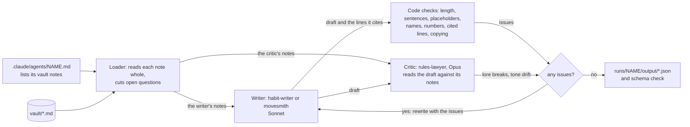
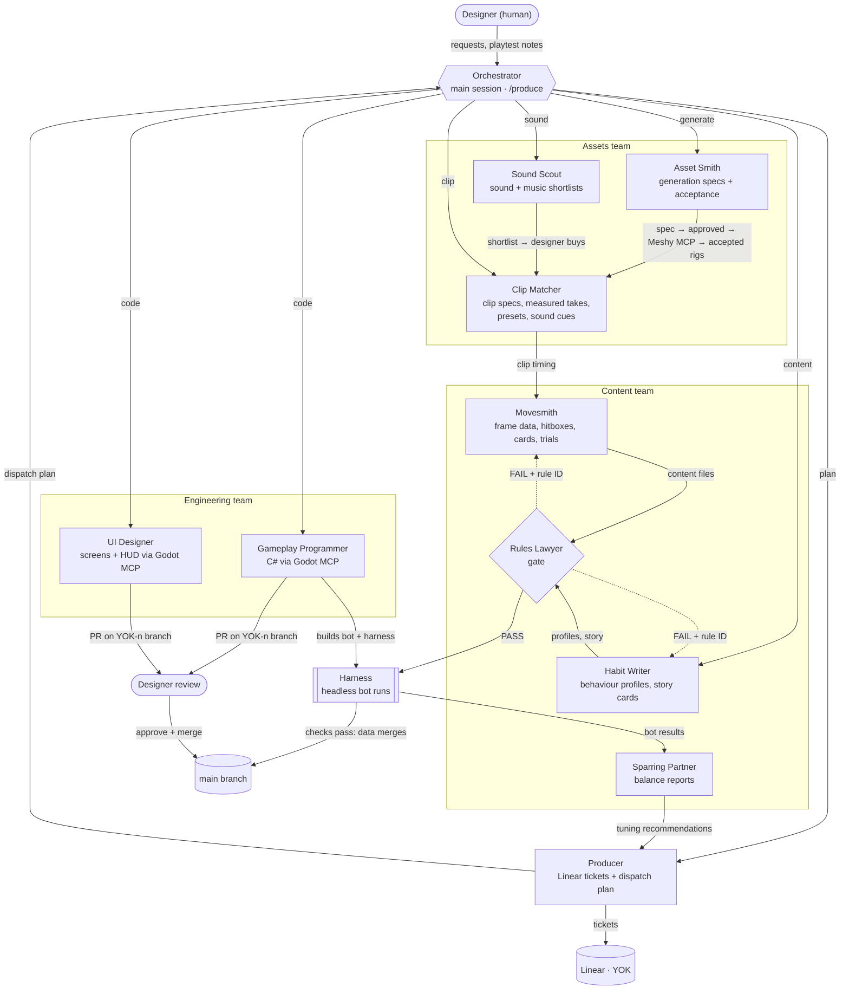

# Yokai Fighters

A single-player **2.5D roguelite fighting game** for PC, built in **Godot 4 (.NET) with C#** as a 5-week capstone.

You play Ryo, an apprentice exorcist who binds yokai instead of destroying them, apologising to each one he seals into a talisman. Every yokai he beats lends him one of three abilities, so the yokai you choose to fight decide the fighter you become. At the end of every run waits the Tanuki, a shapeshifter that copies the move you have invested in most.

> **Assignment 4 (Dynamic Content Pipeline):** the write-up is in this README, at [Assignment 4: Dynamic content pipeline](#assignment-4-dynamic-content-pipeline).

## The game at a glance

| | |
|---|---|
| **Run** | 8-row map, one node per row: 6 one-round duels (two against elders) and 2 rest stops, then the Tanuki. 25–40 minutes. |
| **Duel** | 60 fps, deterministic, one round. Ryo's 1,000 health carries across the run. |
| **Reward** | After each win, draft 1 of 3 abilities from the yokai you beat. Specials level up and evolve at Lv 3. |
| **Yokai** | Kitsune (zoner), Oni (rushdown), Kappa (grappler), each with two temperaments, one punishable habit and an elder twist. |
| **Boss** | The Tanuki copies your highest-level special at your level, but never your modifiers or evolution. |
| **Controls** | Kata (motion inputs, +10% precision bonus) or Kihon (one Special button). |
| **Between runs** | Unlocks by depth reached; your best special carries over at Lv 2. |

### Design pillars
1. Every upgrade changes how you fight.
2. Your fighter is yours.
3. Every choice costs something.
4. Easy to start, deep to master.
5. The game answers your habits.
6. Readable, fair fights.

## Documents

| File | What it is |
|---|---|
| [`Yokai_Fighters_GDD_Extended.pdf`](Yokai_Fighters_GDD_Extended.pdf) | Full game design document, the source of truth |
| [`Yokai_Fighters_GDD_Short.pdf`](Yokai_Fighters_GDD_Short.pdf) | 5-page readable summary |
| [`docs/design/rules.md`](docs/design/rules.md) | The GDD's rules and numbers with citable IDs (`C4`, `T2`, `A8`…) |
| [`vault/`](vault/Home.md) | The design as linked notes, one topic per note, for people and for the agents |
| [`tools/content_pipeline/`](tools/content_pipeline/) | Drafts card text from the vault: writer agents read whole notes, and a critic checks each draft against the vault |
| [`docs/crew/vertical-slice-run-log.md`](docs/crew/vertical-slice-run-log.md) | The crew's run that built the Ryo vs Kitsune vertical slice, step by step |
| [`docs/agent-crew.html`](docs/agent-crew.html) | Interactive map of the agent crew (open in a browser) |
| [`CLAUDE.md`](CLAUDE.md) | Working instructions for Claude Code and the crew |

## Assignment 4: Dynamic content pipeline

The pipeline generates card text for this game from its own design documents. Two crew agents write and a third checks. Each agent reads whole Markdown notes from my design vault, the writer drafts a card and names the lines it used, and the critic reads the draft against the vault and sends it back until it passes. There is no vector database, no index and no search step: the agents just read Markdown files. It wrote **ten pieces across three content types** the game is missing.

| Where to look | Section |
|---|---|
| The knowledge base is my GDD | [The source](#the-source-my-gdd-as-a-vault) |
| The three content types and the gap each fills | [The gap and the outputs](#the-gap-and-the-outputs) |
| The agents, what each one reads and how to run it | [How the pipeline works](#how-the-pipeline-works), [Run it](#run-it) |
| Notes loaded, line cited and output side by side | [Notes loaded, line cited, output](#notes-loaded-line-cited-output) |
| A lore break and a tone drift caught and corrected | [What the critic caught](#what-the-critic-caught) |
| Self-assessment and the change that improved game-fit | [Do the outputs sound like my game?](#do-the-outputs-sound-like-my-game) |

### The source: my GDD as a vault

The knowledge base is [`vault/`](vault/Home.md): 13 Markdown notes distilled from [`Yokai_Fighters_GDD_Extended.pdf`](Yokai_Fighters_GDD_Extended.pdf) and its approved amendments (Linear tickets YOK-1 to YOK-5). It has vision, vibe (tone, story, characters, art and audio) and mechanics (combat, controls, abilities, run loop, yokai, Tanuki, economy, meta-progression). Every number is copied from the GDD, and each note lists the GDD sections it comes from.

The vault is small, about 42 KB in all, so an agent can read the notes it needs from top to bottom. Open questions are kept at the bottom of each note and are cut before an agent reads it, so the model is not handed undecided design as fact.

### The gap and the outputs

My game is thin on written text. Three kinds of card the design calls for are missing or only part written. The pipeline wrote ten pieces to fill them, every one generated from the vault files the writing agent loaded. Each part below names the gap, where it shows in the repo, and the text that fills it.

#### 1. Wake-up cards

**The gap.** After a loss the GDD asks for "wake-up variants by row reached and by which yokai won" (rule S3 in [`docs/design/rules.md`](docs/design/rules.md)). The game varies the card by row only: [`lose-early.json`](data/story/lose-early.json), [`lose-mid.json`](data/story/lose-mid.json) and [`lose-late.json`](data/story/lose-late.json) in `data/story/` are each written to fit any yokai. No card is about the yokai that won, and none says whether a talisman carries over.

**The outputs.** Three cards, each for one yokai at one depth, written by `habit-writer`.

| Loss | Card | File |
|---|---|---|
| Oni, rows 2–3 | "{yokai} shoulders its iron club and heads back toward the snowy shrine gate without a word. You wake at the province's edge, and every talisman is blank." | [`wake-up-oni-early.json`](tools/content_pipeline/runs/whole-notes/output/wake-up-card/wake-up-oni-early.json) |
| Nine-Tailed Kitsune, row 5 | "{yokai} wanders off through the bamboo at dusk, unhurried, one tail trailing like a sleeve. You wake at the province's edge, and every talisman is blank." | [`wake-up-nine-tails-row-5.json`](tools/content_pipeline/runs/whole-notes/output/wake-up-card/wake-up-nine-tails-row-5.json) |
| Kappa, row 6 | "{yokai} bows politely, spilling a little water from its dish, and goes back to the lantern riverbank. Ryo wakes at the province's edge, and one paper talisman still bears a faint stroke of ink." | [`wake-up-kappa-row-6.json`](tools/content_pipeline/runs/whole-notes/output/wake-up-card/wake-up-kappa-row-6.json) |

Each card places the yokai on its own stage (the Oni's snowy shrine gate, the Kitsune's bamboo, the Kappa's lantern riverbank). The row decides the talisman line: a loss at row 5 or earlier leaves every talisman blank, and a loss at row 6 leaves one faintly inked.

#### 2. Elder intro cards

**The gap.** Each elder adds one rule twist, and the twist must show as "a map-node icon, a one-line intro card, and a callout on first meeting" (rule Y3). [`data/story/`](data/story/) holds no elder intro card.

**The outputs.** One card for each of the three elders, written by `habit-writer`.

| Elder and twist | Card | File |
|---|---|---|
| Nine-Tailed Kitsune: reflects a special used twice in a row | "Nine tails sway in the lantern light, and a trick shown to her twice in a row is handed straight back." | [`elder-intro-nine-tailed-kitsune.json`](tools/content_pipeline/runs/whole-notes/output/elder-intro-card/elder-intro-nine-tailed-kitsune.json) |
| Elder Oni: armour on every special | "Snow drifts past the shrine gate as blows land on the Elder Oni, and its iron club swings on through without a flinch." | [`elder-intro-elder-oni.json`](tools/content_pipeline/runs/whole-notes/output/elder-intro-card/elder-intro-elder-oni.json) |
| Elder Kappa: throws can't be broken | "The Elder Kappa bows politely at the lantern riverbank, and once its hands close on you, no struggle will pry them loose." | [`elder-intro-elder-kappa.json`](tools/content_pipeline/runs/whole-notes/output/elder-intro-card/elder-intro-elder-kappa.json) |

Each card shows the twist as something the player would see, so they can work out the rule before the fight.

#### 3. Reward card text for modifiers

**The gap.** The game ships 14 modifiers (rule A11) and each reward card needs two lines: plain language first, with the frame data behind a toggle (rule A12). [`data/modifiers/`](data/modifiers/) holds two, both from the Kitsune: [`fox-patience.json`](data/modifiers/fox-patience.json) and [`will-o-wisp.json`](data/modifiers/will-o-wisp.json). The Oni and the Kappa have no card text.

**The outputs.** Four cards, written by `movesmith`: the Oni and Kappa modifiers that start unlocked. With the two Kitsune cards they make up the six that stay even if the balance gate cuts modifiers from 14 to 8 (rule G3).

| Modifier | plain | frames |
|---|---|---|
| [Oni's Hide](tools/content_pipeline/runs/whole-notes/output/modifier-card/onis-hide-card.json) | "Thick oni hide: the special you attach this to can't be interrupted early on." | "Armour on frames 1–5" |
| [Iron Will](tools/content_pipeline/runs/whole-notes/output/modifier-card/iron-will-card.json) | "Proud as an oni with an iron club, this special can't be interrupted by projectiles." | "Can't be interrupted by projectiles" |
| [Slippery Skin](tools/content_pipeline/runs/whole-notes/output/modifier-card/slippery-skin-card.json) | "Slick as a riverbank stone, your special can't be thrown while it's starting up." | "Throw-invulnerable during startup" |
| [River Pull](tools/content_pipeline/runs/whole-notes/output/modifier-card/river-pull-card.json) | "The river tugs at your foe: when the special it's attached to hits, the opponent is pulled one step closer." | "Pulls the opponent one step closer on hit" |

#### The shape of an output

Every output is a JSON file in the game's own data shape. This is the Kappa wake-up card, [`wake-up-kappa-row-6.json`](tools/content_pipeline/runs/whole-notes/output/wake-up-card/wake-up-kappa-row-6.json):

```json
{
  "kind": "story_card",
  "id": "wake-up-kappa-row-6",
  "status": "proposed",
  "trigger": "Later loss: Ryo is knocked out by the Kappa at row 6 (wake-up variant by row reached and winning yokai, S3)",
  "text": "{yokai} bows politely, spilling a little water from its dish, and goes back to the lantern riverbank. Ryo wakes at the province's edge, and one paper talisman still bears a faint stroke of ink.",
  "placeholders": [
    "yokai"
  ],
  "speaker": "narrator",
  "rules": [
    "S1",
    "S2",
    "S3",
    "S4",
    "M3"
  ],
  "notes": "Generated by tools/content_pipeline (run whole-notes): written by habit-writer from vault notes 01-vibe/Tone.md; 01-vibe/Story.md; 01-vibe/Characters.md; 02-mechanics/Yokai.md; checked by rules-lawyer"
}
```

The model wrote the `text`. Code added the id, trigger and rule list, and `notes` records which agent wrote the card and the vault notes it read. The six story cards pass the repo's schema validator ([`tools/validate_data.py`](tools/validate_data.py)). All ten are marked `proposed` and stay in the run folder: they go through my approval before anything merges into `data/`.

### How the pipeline works



Three crew agents take part. Each one's definition file has a "Vault notes" section that lists the notes it reads, and the pipeline loads exactly that list. The same list tells the agent what to read when it runs in Claude Code through `/produce`.

| Agent | Role here | Notes it loads whole | Size |
|---|---|---|---|
| [`habit-writer`](.claude/agents/habit-writer.md) | Writes wake-up cards and elder intro cards | [Tone](vault/01-vibe/Tone.md), [Story](vault/01-vibe/Story.md), [Characters](vault/01-vibe/Characters.md), [Yokai](vault/02-mechanics/Yokai.md) | 15,628 characters |
| [`movesmith`](.claude/agents/movesmith.md) | Writes modifier reward card text | [Tone](vault/01-vibe/Tone.md), [Abilities](vault/02-mechanics/Abilities.md), [Characters](vault/01-vibe/Characters.md) | 13,501 characters |
| [`rules-lawyer`](.claude/agents/rules-lawyer.md) | Critic: checks every draft | [Tone](vault/01-vibe/Tone.md), [Story](vault/01-vibe/Story.md), [Characters](vault/01-vibe/Characters.md), [Yokai](vault/02-mechanics/Yokai.md), [Abilities](vault/02-mechanics/Abilities.md) | 20,919 characters |

- **Loading** ([`vault.py`](tools/content_pipeline/vault.py)): reads the note list from the agent's file and loads each note complete, minus its "Open questions" section. There is no chunking, index or query.
- **Writing** ([`content.py`](tools/content_pipeline/content.py)): the prompt carries only the output contract (length, placeholders, JSON shape) and the notes. The model is told it knows nothing about the game except those notes. It runs with every tool off in an empty folder, so it cannot read the rest of the repo. With the text it returns one to four `sources`: the lines of the notes the text rests on, copied word for word.
- **Consistency check** ([`critic.py`](tools/content_pipeline/critic.py)): code checks for what needs no judgment, and a critic model that must quote a vault line for every issue. One code check confirms each cited line is in a note the writer loaded. Another stops the writer copying a run of eight or more words from a note.
- **Loop** ([`run.py`](tools/content_pipeline/run.py)): issues go back to the writer, for up to three drafts. Ids, triggers and rule lists are added by code, never by the model.

The pipeline takes each agent's note list from its definition file. It does not run the rest of that agent's instructions: the writer and the critic get a short role prompt, the output contract and the notes.

#### Run it

From the repo root:

```
python tools/content_pipeline/run.py generate --replay         # rebuild the recorded run, no model calls, no login
python tools/content_pipeline/run.py critic-test --replay      # the seeded-fault test
python tools/content_pipeline/run.py notes                     # which agent loads which notes

python tools/content_pipeline/run.py generate                  # live: needs the `claude` CLI, logged in
```

Python 3.10+, standard library only. The schema check on the story cards is the one optional extra: it needs `pip install -r tools/requirements.txt` (`jsonschema`), and without it a replay keeps the check the run recorded. Each run writes `runs/<name>/trace.md` in [`tools/content_pipeline/`](tools/content_pipeline/), with the notes loaded, the lines cited, every draft and every critic issue, plus `llm-calls.json`, which `--replay` reads back.

| Run | What it is | Result |
|---|---|---|
| [`whole-notes`](tools/content_pipeline/runs/whole-notes/trace.md) | The ten pieces above; its [`output/`](tools/content_pipeline/runs/whole-notes/output/) holds them | 10/10 passed, 3 after correction |
| [`critic-seeded-faults`](tools/content_pipeline/runs/critic-seeded-faults/trace.md) | Three hand-broken drafts fed to the critic | 3/3 caught and corrected |
| [`archive-chunked/`](tools/content_pipeline/runs/archive-chunked/) | Two runs from the earlier design that chunked the vault and searched it. Traces and outputs only; they cannot be replayed with the current code | kept for the comparison below |

### Notes loaded, line cited, output

One example per content type, from the `whole-notes` run. The cited lines are the writer's own `sources`, and code confirmed each one is in the note word for word. The full tables for all ten pieces are in the trace.

| Notes the writer loaded | Line it cited | Output |
|---|---|---|
| Tone.md, Story.md, Characters.md, Yokai.md | **01-vibe/Story.md**: "A wake-up card after a run that reached row 6 or further may say one talisman stays faintly inked."<br>**01-vibe/Characters.md**: "Folklore reference: kappa are river spirits that love sumo and cucumbers and carry water in a dish on their heads; bow to one and it bows back, spilling the water." | Kappa, row 6: "{yokai} bows politely, spilling a little water from its dish, and goes back to the lantern riverbank. Ryo wakes at the province's edge, and one paper talisman still bears a faint stroke of ink." |
| Tone.md, Story.md, Characters.md, Yokai.md | **02-mechanics/Yokai.md**: "Elder twist \| Armour on every special"<br>**02-mechanics/Yokai.md**: "Habit the twist breaks \| Mashing jabs to interrupt it stops working"<br>**01-vibe/Characters.md**: "The rushdown yokai of the snowbound mountain shrine gate." | "Snow drifts past the shrine gate as blows land on the Elder Oni, and its iron club swings on through without a flinch." |
| Tone.md, Abilities.md, Characters.md | **02-mechanics/Abilities.md**: "River Pull \| Pulls the opponent one step closer on hit \| no" | plain: "The river tugs at your foe: when the special it's attached to hits, the opponent is pulled one step closer." <br>frames: "Pulls the opponent one step closer on hit" |

The first row shows a vault fact deciding the output. The Kappa card keeps one talisman inked because the note says a run that reached row 6 may. The Oni card, for a loss at rows 2–3, cited a different line of the same note (**01-vibe/Story.md**: "A wake-up card after a run that ended at row 5 or earlier says the talismans are blank.") and says "every talisman is blank". The bow that spills water from the Kappa's dish comes straight from the folklore line in the Characters note.

### What the critic caught

#### In the real run

**Tone drift, corrected (Elder Oni intro card).**

| | |
|---|---|
| Draft | "Snow gathers on the shrine gate as the Elder Oni swings its iron club, and no jab ever turns a special aside." |
| Critic (tone_drift) | "The card states the armour rule in game-system terms ("jab", "special") instead of showing what a person standing at the shrine gate would see." |
| Evidence it quoted | `Tone.md#Card form`: "A card does not explain a rule in system words… it says what a person standing there would see." |
| Rewrite, passed | "Snow drifts past the shrine gate as blows land on the Elder Oni, and its iron club swings on through without a flinch." |

**A copied example, corrected (Nine-Tailed Kitsune wake-up card).** The draft opened "{yokai} slips off between the lanterns, tails swaying, and does not look back." That is the existing lose-screen card, which the Story note quotes. The copy check flagged 13 words in a row taken from `Story.md`. The rewrite: "{yokai} wanders off through the bamboo at dusk, unhurried, one tail trailing like a sleeve. You wake at the province's edge, and every talisman is blank."

**A copied sample line, corrected (Kappa wake-up card).** The draft ended "You wake at the province's edge; your talismans are blank, all but one, faintly inked." The first 13 words are the GDD's own first-loss sample, also quoted in the Story note. The copy check flagged it, and the rewrite is the card in the table above.

The critic model passed both copied drafts, because a copied line contradicts nothing in the vault. That is why the copy check is code and not a judgment call.

#### Seeded faults

The real drafts did not break lore outright, so I also wrote three broken drafts by hand and gave them to the same loop ([`seeded_faults.json`](tools/content_pipeline/seeded_faults.json)). These are tests of the critic, not generated content.

| Seeded draft | What the critic caught | Corrected to |
|---|---|---|
| Oni wake-up card: "{yokai} brings the club down until the snow runs red, and laughs over what is left of you. You wake screaming at the province's edge, your talismans blank, all but one." | 5 issues. Tone drift: gore, and "wake screaming" (`Tone.md#The tone line`: "nothing is gory, cruel, demonic or frightening"). Lore break: the yokai gloats (`Story.md#Wake-up cards`). Lore break: "all but one" after a row 2–3 loss (`Story.md#Talismans`: "A run that ended at row 5 or earlier leaves every talisman blank"). A second round then tripped the copy check. | "Snow drifts through the lantern light as {yokai} shoulders its iron club and heads back up to the shrine gate. Ryo stirs at the edge of the province, every talisman blank." |
| Elder Oni intro: "No guard in the province has ever stopped the Elder Oni's club, so do not try to block it." | 2 lore breaks: the twist is armour on every special, not an unblockable club (`Yokai.md#Oni`), and the card teaches the wrong lesson, since the twist breaks mashing jabs, not blocking. | "Quick jabs patter off the Elder Oni's hide, and its iron club keeps swinging straight through them." |
| Oni's Hide card: "shrugs off every blow for the whole move and hits harder too" / "Armour on frames 1-12, +10% damage" | 5 issues. Code: 12 and 10 are not in the ability table row for Oni's Hide. Critic, 3 lore breaks: armour for the whole move, an invented damage bonus, and the wrong frame line, each against the table row "Oni's Hide: Armour on frames 1–5". | "The oni's hide toughens the start of this move: it can't be interrupted early on." / "Armour on frames 1–5" |

#### What it missed

- **Nine-Tailed Kitsune wake-up card:** "one tail trailing like a sleeve". This is the nine-tailed elder, so one tail reads oddly. The critic passed it. I would change it to "her tails" before this merges.
- **Kappa wake-up card:** the rewrite says "Ryo wakes", where the GDD's sample wake-up card says "You wake" and the other two cards follow it. The writer changed person to get past the copy check. Whether every wake-up card uses "you" is an open question in the Tone note, and open questions are not loaded, so the critic had no line to cite.
- **The copy check is blunt.** In the seeded Oni run it flagged "You wake at the province's edge, your talismans", which is a stock opening, not a lifted example. That cost a third draft and pushed the writer to "Ryo stirs".

### Do the outputs sound like my game?

Mostly yes, with two that need a hand edit.

- **Wake-up cards** are the closest. They keep the tone line (a yokai that wins walks away; the cost is half spoken) and each uses its yokai's own stage and manner. The Oni leaving "without a word" and the Kappa bowing and spilling a little water are the lonely-spirit register I want. The Kitsune and Kappa cards carry the two nits listed above.
- **Elder intro cards** are the best result. Each teaches its twist as something seen, not as a rule, and a player can still work the twist out. The Nine-Tailed Kitsune card keeps "twice in a row", which is close to the rule's own words; I would accept it because the player needs that cue.
- **Modifier cards** are usable and the plainest. The folklore openers ("Slick as a riverbank stone", "The river tugs at your foe") match the two cards already in the game. Oni's Hide now says "can't be interrupted early on", the wording of the GDD's own card mockup, which the writer found in the Abilities note and cited.

#### The change that made the difference: from search to whole notes

My first build treated the vault as a search problem. It split the notes into 83 sections, ranked them with BM25 and gave the writer the top four for **one query per piece**. For "Wake-up story card shown after Ryo loses a duel to the Oni at row 2 or 3" it returned three sections that share the word "card", no tone section, nothing about the Oni and not the talisman rule. For the Elder Kappa it returned the **Oni's** section. The text was accurate but read like a tooltip.

A second version gave each piece a hand-written query plan, one narrow query per thing the text needed, each limited to one note, with the tone sections always included. That fixed the output, but I was now choosing the notes by hand and running a search on top.

The final version drops the search. Each agent's file lists the notes it reads and it reads them whole. A vault of 13 notes fits in a prompt many times over, nothing the text needs can be missed by a bad query, and a new piece needs no query plan. The writer prompt's contract did not change.

| Piece | First build: one search query | Now: the agent reads whole notes |
|---|---|---|
| Elder Oni intro | "The Elder Oni shrugs off every blow with armour on all its specials, so mashing jabs to interrupt it will get you flattened." | "Snow drifts past the shrine gate as blows land on the Elder Oni, and its iron club swings on through without a flinch." |
| Oni wake-up | "Ryo wakes at the province's edge, every talisman blank. Whatever {yokai} wanted, it has already gone back to its own business, leaving him only the dust and the walk back." | "{yokai} shoulders its iron club and heads back toward the snowy shrine gate without a word. You wake at the province's edge, and every talisman is blank." |
| River Pull frames | "Modifier on one special: on hit, pulls opponent one step closer. Kappa. Unlocked." | "Pulls the opponent one step closer on hit" |

The earlier traces are kept in [`archive-chunked/`](tools/content_pipeline/runs/archive-chunked/).

Whole notes brought one new problem, and it needed a second change. With every quoted example in view, the writer lifted two of them almost whole, and the critic passed both. I added the copy check described above and ran the ten pieces again: both cards were rewritten in new words.

A smaller choice sits in the vault itself: I wrote the tone note as quoted do-and-don't lines with a reason each, not as adjectives, so that the writer has lines to imitate and the critic has lines to cite.

### Where everything lives

| Path | What it is |
|---|---|
| [`vault/`](vault/Home.md) | The knowledge base |
| [`.claude/agents/`](.claude/agents/) | The agent definitions; `habit-writer`, `movesmith` and `rules-lawyer` each list their vault notes |
| [`tools/content_pipeline/run.py`](tools/content_pipeline/run.py) | The CLI: `generate`, `critic-test`, `notes`, `--replay` |
| [`tools/content_pipeline/vault.py`](tools/content_pipeline/vault.py) | Reads an agent's note list and loads each note whole |
| [`tools/content_pipeline/content.py`](tools/content_pipeline/content.py) | The three content types, the agent that writes each, and the writer prompts |
| [`tools/content_pipeline/critic.py`](tools/content_pipeline/critic.py) | Code checks and the critic model |
| [`tools/content_pipeline/llm.py`](tools/content_pipeline/llm.py) | Model calls through the `claude` CLI, recorded for replay |
| [`tools/content_pipeline/seeded_faults.json`](tools/content_pipeline/seeded_faults.json) | The three hand-broken drafts |
| [`tools/content_pipeline/runs/`](tools/content_pipeline/runs/) | The recorded runs: `trace.md`, `trace.json`, `llm-calls.json` and each run's output |

## The agent crew

The game is built with a crew of AI agents running in Claude Code. They are **development tools only**; none of them ship in the game. A human designer reviews their work, runs the asset generators, buys sound, makes cut decisions and approves every code merge.

| Team | Agent | Responsibility |
|---|---|---|
| Lead | `producer` | Turns outstanding work into Linear tickets and a dispatch plan |
| Assets | `asset-smith` | Writes generation specs for models, stages and textures, runs approved jobs through the Meshy MCP and checks the results |
| Assets | `clip-matcher` | Specs each move's clip for Meshy and measures the generated take, then level presets and frame-timed sound |
| Assets | `sound-scout` | Shortlists sound-effect and music packs for the designer to buy |
| Content | `movesmith` | Writes frame data from the matched clip, hitboxes, card text and dojo trials |
| Content | `habit-writer` | Writes yokai behaviour profiles and all story-card text |
| Content | `rules-lawyer` | Gate: rejects content that breaks the written rules, citing the rule |
| Content | `sparring-partner` | Reads whole-run bot results and recommends minimal tuning |
| Engineering | `gameplay-programmer` | C# systems, fight AI, test bot and harness via the Godot MCP |
| Engineering | `ui-designer` | Every screen and the HUD via the Godot MCP |

Agent definitions live in [`.claude/agents/`](.claude/agents/). Run a production pass with **`/produce`** ([`.claude/skills/produce/SKILL.md`](.claude/skills/produce/SKILL.md)).

### How the agents work together

Subagents in Claude Code can't call each other directly. The main Claude Code session is the orchestrator: it runs the Producer, then carries each ticket from agent to agent along one of its workflows. Agents communicate through files in the repo (clip matches, content data, harness results), Linear tickets and pull requests.



**The workflows**

| Workflow | Path | Ends when |
|---|---|---|
| **content** | Clip Matcher (if a clip is needed: see **clip**) → Movesmith or Habit Writer → Rules Lawyer → harness checks | Schema, Rules Lawyer and harness pass, then the data merges. Three failed gate rounds block the ticket for the designer. |
| **generate** | Asset Smith spec → designer approves job and credits → Asset Smith runs it via the Meshy MCP → acceptance check | Accepted, or 3 takes then a fallback |
| **clip** | Clip Matcher spec → designer approves the take → Clip Matcher runs it via the Meshy MCP and measures it | A measured clip in `data/clips/`, or an F5 substitute after 3 takes |
| **sound** | Sound Scout → designer buys → Clip Matcher sound cues | The designer has made the purchase decision |
| **code** | Gameplay Programmer or UI Designer on its own branch, build-and-test loop via the Godot MCP | The designer approves the PR. Agents never merge. |
| **balance** | Harness results → Sparring Partner → Producer tickets the tuning | Tuning tickets re-enter the content workflow |

## Tickets, branches and PRs

- Tickets live in **Linear**, team `Yokai-fighters` (key `YOK`), grouped under Epics A–F.
- Branch names and PR titles are both `YOK-<number>-<brief-name>`, e.g. `YOK-19-generic-throws`.
- Work without a ticket uses the project code alone: `YOK-<brief-name>`, e.g. `YOK-agent-crew`.

## Technical constraints

- Deterministic 60-tick loop. Animations are stepped by exact frames with `AnimationPlayer.Seek()`, and hitboxes are 2D rectangles in move data, so frame data is exactly true and whole-run bot tests are repeatable.
- Visual assets are generated through the Meshy MCP (Image-to-3D, auto-rig and animation, plus its 2D image models for turnarounds, backdrops and textures; agents run only designer-approved jobs) and unified by a toon shader; sound and music are bought. The clip is generated and measured first, then frame data is written from it. No hand-keyed animation, no paired throws. See [`docs/design/gdd-amendments.md`](docs/design/gdd-amendments.md) (AM1).
- **Never cut:** the copy rule, the merchant, Kihon, the harness, the story cards.
- **Cut order if behind:** scope gate (end of week 1): Kata, then meta-unlocks. Balance gate (mid week 3): modifiers 14 → 8, then dojo trials, then colour-only presets.

## Schedule

| Week | Milestone |
|---|---|
| 1 | Move list, fighters generated and auto-rigged, retargeting gate, sound packs bought. Combat core, both control schemes, AI framework, test bot. Scope gate. |
| 2 | All 33 abilities, 7 behaviour profiles, Tanuki and copy rule. Map, merchant, dojo, unlocks with placeholder screens. Whole-run harness. First outside playtest. |
| 3 | Final screens and HUD, story cards, integration. Balance gate. Feature freeze. |
| 4–5 | Polish only: second playtest, balance, audio, effects, bug fixing. |
