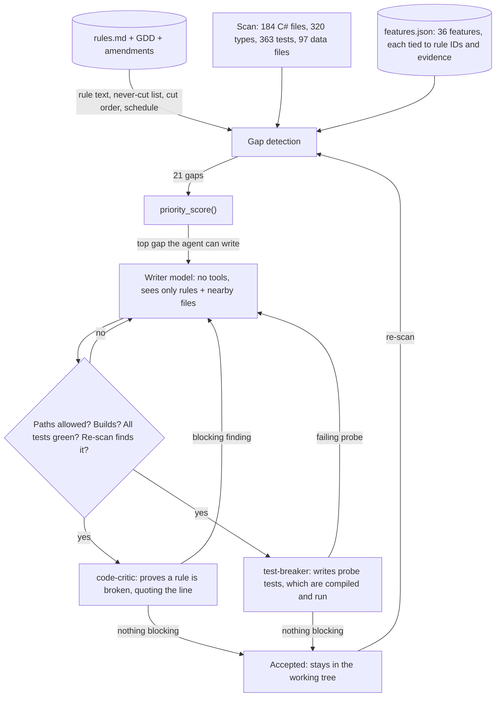

# Assignment 5: Goal-Oriented Coding Agent

**Game: Yokai Fighters.** My capstone is a single-player 2.5D roguelite fighting game (Godot 4, C#). Ryo, an apprentice exorcist, binds yokai and drafts their abilities; the Tanuki boss copies the special he has invested in most.

The agent's goal is one sentence: **every feature the design requires is in the codebase.** It reads the design, scans the code, finds what is missing, decides what to build next, writes it, and scans again. It wrote the rule the whole game is built around, the Tanuki's copy target, and that code builds and runs in the game's own test runner.

There was no starter code. Everything in [`tools/goal_agent/`](../../tools/goal_agent/) is new.

## The three deliverables

| Deliverable | Where |
|---|---|
| Source code | [`tools/goal_agent/`](../../tools/goal_agent/): about 1,450 lines of Python, standard library only, plus 22 unit tests |
| Working feature | [`game/scripts/Sim/Run/CopyRule.cs`](../../game/scripts/Sim/Run/CopyRule.cs), the changes to [`RunState.cs`](../../game/scripts/Sim/Run/RunState.cs), and [`game/tests/CopyRuleTests.cs`](../../game/tests/CopyRuleTests.cs) |
| README | this file |

## How the agent works



| Part the assignment asks for | File | What it does |
|---|---|---|
| Reads the GDD | [`gdd.py`](../../tools/goal_agent/gdd.py) | Parses the 108 rules in `docs/design/rules.md` (my GDD distilled into citable IDs), the GDD transcription by section, and the amendments. From section G it reads what is never cut (G1), what is cut first (G2, G3) and which week each milestone belongs to (G5). |
| Scans the codebase | [`scan.py`](../../tools/goal_agent/scan.py) `scan()` | Walks `game/scripts`, `game/tests` and `data`: every C# type, public member and `[Test]`, every data file. |
| **Gap-detection pass** | [`scan.py`](../../tools/goal_agent/scan.py) `detect_gaps()` | Checks each feature's evidence against the scan: present, partial or missing. Comments are stripped first, so `// copy rule not built here` cannot make the copy rule look built. |
| **`priority_score()`** | [`priority.py`](../../tools/goal_agent/priority.py) | One number per gap, with the reason for every point. See below. |
| **Code-writing step** | [`writer.py`](../../tools/goal_agent/writer.py) | Prompts a model with the rule text and the files next to the feature, parses its answer and writes it. It may only create or edit the files the feature names, can never edit an existing test, and every write is snapshotted so a rejected attempt is undone completely. |
| Verifying what it wrote | [`verify.py`](../../tools/goal_agent/verify.py) | `dotnet build`, then the game's headless test runner inside Godot. |
| Adversarial critics | [`critics.py`](../../tools/goal_agent/critics.py) | See "The adversaries". |
| **Iteration loop** | [`run.py`](../../tools/goal_agent/run.py) `cmd_build()` | Scan, detect, rank, write the top gap, then scan again from scratch. Stops when nothing is missing, when nothing that is left can be written by the agent, or when the run's budget is spent, and says which. |

### What "required" means

[`features.json`](../../tools/goal_agent/features.json) is the bridge between the design and the code: 36 features, each with the rule IDs it implements and the evidence that proves it exists (a type, a test class, a count of data files). I wrote it by hand, and the agent holds it to the design: it refuses to run if a feature cites a rule that is not in `rules.md`, names a milestone the schedule does not use, points at the full-game stretch section, or if any of the 108 rules is covered by no feature and not explicitly listed as untracked. Priority is not stored in that file at all.

### `priority_score()`

Every input is a fact read from the design or from the scan. If I edit rule G1, the ranking changes with no change to the tool.

| Factor | Points | Read from |
|---|---|---|
| Never cut | +40 | G1: the copy rule, the merchant, Kihon, the harness, the story cards |
| Schedule | +10 × urgency (3 = due this week or late, down to 0) | G5, against the build week counted from the first commit |
| Unblocks | +6 per unbuilt feature waiting on it, up to 5 | the `needs` graph, followed through chains |
| Cut risk | −4 to −20, the first cut lowest | G2, G3: Kata, the meta-unlock layer, modifiers, dojo trials, presets |
| Size | −5 × size (1 to 3) | the feature |
| Started | +5 | the scan finds part of it |

A feature whose prerequisites are missing is not ranked: it is blocked, and being waited on is what raises the score of the feature it needs. Content and UI gaps, and code gaps with no build brief, are reported with their owner (Movesmith, Habit Writer, UI Designer) and left to the crew.

### The adversaries

A writer that grades its own work will pass it. So after the mechanical gates (allowed paths, build, every existing test, the re-scan), two critics with the opposite incentive get the change:

- **code-critic** is told to assume the code is wrong and prove it against the rule text. A finding only counts if the line it quotes is really in the file and the rule it cites is really in `rules.md`; anything else is thrown away and logged. This stops a critic inventing problems.
- **test-breaker** does not argue. It writes up to eight probe tests whose expected values come from the rules, and the agent compiles and runs them in the game's test runner. A probe that fails is the finding. A probe that does not compile is discarded.

A blocking finding removes the attempt from the repo and goes back to the writer with the critic's reasoning. The writer may dispute a probe by naming the rule ID; disputed probes are not argued further, they are listed for me to decide. Advisory findings never block: they are the suggested changes in the final report.

Before the model critics run, plain code checks reject what is never acceptable here: Godot types, floats, clocks or unseeded randomness in simulation code, yokai or ability ids hard-coded in shipping code, tests that read `data/` instead of fixtures.

### Run it

From the repo root:

```
python3 tools/goal_agent/run.py gaps                         # what is missing, ranked, with reasons. No model calls.
python3 tools/goal_agent/run.py gaps --json                  # the same, for the producer agent
python3 tools/goal_agent/run.py build --run NAME             # write the top-ranked gap, re-scan, stop
python3 tools/goal_agent/run.py build --run NAME --max-features 3
python3 tools/goal_agent/run.py critic-test                  # seed faults into accepted code, see who catches them
python3 -m unittest discover -s tools/goal_agent -p 'test_*.py'
```

`gaps` needs only Python 3.10+. `build` also needs the `claude` CLI (logged in), `dotnet` and `godot` on PATH, and a branch other than `main`: the agent writes to the working tree and never commits, pushes or merges. Each run writes `runs/<name>/trace.md` with every decision, plus `llm-calls.json` with every prompt and reply.

## What the agent built

**The Tanuki's copy target** (rules T2, T3, T4; GDD 5.3). Recorded run: [`runs/v1-copy-target/trace.md`](../../tools/goal_agent/runs/v1-copy-target/trace.md).

The Tanuki boss copies one of Ryo's specials. Until now nothing in the game could say which one. The agent wrote:

- `CopyRule.Target(RunState)`: the highest-level special in a slot (T2), ties to the one levelled most recently, then the lower slot (T3).
- `CopyTarget.Build()`: the copy's move at Ryo's level, never with his modifier and never with the Lv 3 evolution (T4), so an evolved move always beats its copy.
- In `RunState`: the run did not record when a special gained a level, which T3 needs. The agent added it, put it in the run's state hash only for runs where something has levelled (so existing hashes hold), and added a way to restore it for the later save system.
- 17 tests, one per clause of the rules.

**It runs.** The game's headless test runner went from 363 passing tests to 380, with none failing:

```
cd game && dotnet build
godot --headless --path . res://tests/test_runner.tscn     # ... TESTS 380 passed, 0 failed
```

It is simulation code with no screen of its own yet. The HUD talisman that glows for the copy target (T6) is the next gap in the same chain and belongs to the UI Designer; the agent reports it rather than writing it, because its acceptance is visual.

## Why the agent chose it

It was not told to. On the first scan it found 15 of 36 features present and ranked the 21 gaps; five were ones it could write at that moment:

| Rank | Feature | Score |
|---|---|---|
| 1 | `copy-target` (T2, T3, T4) | 95 |
| 2 | `merchant-heal` (R6) | 83 |
| 3 | `dojo-rest` (R7) | 43 |
| 4 | `coins` (R8) | 37 |
| 5 | `unlocks` (M1) | 9 |

The score for `copy-target`, as the agent printed it:

| Factor | Points | Why |
|---|---|---|
| never cut | +40 | G1 lists "copy rule" |
| schedule | +30 | G5 puts "copy rule" in week 2; now week 2: due this week or late |
| unblocks | +30 | 7 unbuilt features wait on it: copy-lock, copy-target-hud, merchant-shop, rest-stop-screen, tanuki-fighter, tanuki-pressure, whole-run-harness |
| size | −5 | size 1 of 3 |
| **total** | **95** | |

The merchant's heal is also never cut and also due this week. The copy target won on one thing: seven other gaps cannot start without it, including the Tanuki fight itself and the harness. `unlocks` came last because G2 names the meta-unlock layer as the second thing cut if the build falls behind.

After the write, the agent scanned again: 16 present, `copy-target` gone from the list, and `copy-lock` (T1), blocked a moment earlier, now ranked first at 83. It stopped there because the run's budget was one feature.

## What the critics did to it

The feature took three attempts. The first two built, passed every test and passed all eight probes, and were still rejected:

| Attempt | Mechanical gates | code-critic | test-breaker | Result |
|---|---|---|---|---|
| 1 | build ok, 375 tests green | The level-up order decides the copy target but is not in `StateHash()`: two runs with the same hash get different copy targets, and a restored run can silently change its target. | 8 probes, 0 failed | rejected |
| 2 | build ok, 379 green | The new restore method stores any positive number: restore `int.MaxValue`, level another special, and the order wraps negative, so the wrong special wins the T3 tie. | 8 probes, 0 failed | rejected |
| 3 | build ok, 380 green | 4 advisory findings, none blocking | 7 probes, 0 failed | **accepted** |

Every finding the critic made across the run quoted a real line and a real rule; none had to be thrown away. Nine model calls in total.

### Do the critics work, or do they just complain?

A critic that always finds something proves nothing. So [`seeded_faults.json`](../../tools/goal_agent/seeded_faults.json) holds three faults I wrote by hand, each one line that breaks a rule in the accepted code. `critic-test` puts each one in, runs the gates as in a real attempt, and takes it out again. The critics see the whole files with no hint of where the fault is. Recorded run: [`runs/critic-seeded-faults/trace.md`](../../tools/goal_agent/runs/critic-seeded-faults/trace.md).

| Seeded fault | Rule | My agent's own tests | code-critic | test-breaker |
|---|---|---|---|---|
| Ties go to the least recently levelled special instead of the most recent | T3 | 7 fail | found it: "The tie-break is inverted", `CopyRule.cs:55` | 5 probes fail |
| The copy of a Lv 3 special keeps Ryo's evolution | T4 | 1 fails | found it: the constant "never clamps", `CopyRule.cs:35` | 1 probe fails |
| A full tie goes to the higher slot instead of the lower | T3 | 2 fail | found it: "the HIGHER slot wins", `CopyRule.cs:54` | 3 probes fail |

All three were caught three ways, and each critic finding named the seeded line itself rather than something nearby. With no fault seeded, the same critics passed the same code with nothing blocking, so they tell broken code from working code. Six model calls.

## Manual changes before accepting the code

**To the generated game code: none so far.** `CopyRule.cs`, the `RunState.cs` changes and `CopyRuleTests.cs` are in the working tree exactly as the agent's third attempt wrote them. The three attempts were corrected by the agent's own critics, not by me.

**To the agent's inputs, before the run:** the first version of the feature's brief allowed the writer only `CopyRule.cs` and its test file. T3's "most recently levelled" cannot be answered without the run recording level-ups, so I added `RunState.cs` to the files the feature may edit. That is the one place where I had to understand the feature better than the agent's manifest did.

**Still to do by hand before it merges.** Code only merges after my review, and the critics left four suggested changes that did not block acceptance. These are mine to take or leave:

1. `CopyRuleTests.cs:325`: one assertion takes its "before" hash too early, so it cannot fail for the reason it names. Take the hash after the Foxfire equip. This one is simply right.
2. `CopyRuleTests.cs`: T2 says "throws included" and no test uses a throw special. Add one.
3. `CopyRule.cs:25`: `CopyTarget.Build` always uses the default sim config while Ryo's move uses the match's. Pass the config through before the Tanuki fighter is built on top of it.
4. `RunState.cs:189`: the level-up order is hashed for every run with a level-up, even where it cannot change the result. Either narrow it or accept that recorded hashes of such runs change. No recorded replay in the repo is affected today (all 380 tests pass, including the replay tests).

And two decisions the writer flagged because the rules are silent, which only I can make:

- T3 counts a gained level as "levelled". A newly drafted Lv 1 special has not levelled, so a run where everything is Lv 1 resolves to the lower slot (Spirit Wave), not to the newest pick.
- T4 says the copy never has the evolution. The writer read that as: a copy of a Lv 3 special runs the Lv 2 numbers.

The two `.cs.uid` files beside the new scripts were generated by Godot's import step, not by the agent.

## Which existing agents became goal-oriented

My crew from assignment 3 has ten agents. I went through each and asked one question: can it measure for itself whether it is finished, and is it safe for it to keep going until it is?

| Agent | Goal-oriented now? | Why |
|---|---|---|
| `producer` | **Yes** | It planned by reading the ticket board, which only shows work someone already thought of. It now starts every pass with `run.py gaps --json` and tickets the gaps in score order. Its pass is done when every gap is ticketed, blocked with a reason, or waiting on me. |
| `gameplay-programmer` | **Yes** | It already looped on build and tests. It now has a stated goal and stop condition: the gap its ticket names is reported present by the scan, not "the code is written". |
| `ui-designer` | No, but it gets the critics | Whether a screen is finished is a visual judgment against the concept art, and that is mine. A loop cannot check it. |
| `movesmith`, `habit-writer` | No | Their counts are easy to measure (33 abilities, 7 profiles) and the gap report now shows them, but every move waits on a clip I have approved. A loop would stall on me or write frame data with no clip, which rule F2 forbids. |
| `asset-smith`, `clip-matcher`, `sound-scout` | No | Each step spends generation credits or money. An agent that pursues a goal by spending is the one I least want looping unattended. |
| `rules-lawyer` | No, deliberately | It is a gate. A gate with a goal of its own, such as "get content merged", is biased toward passing. Its job is to have no stake in the outcome. |
| `sparring-partner` | No | It reads results and recommends. If it could change the numbers to hit its own targets, it would be marking its own homework. |

Two new agents, both adversarial, both for code, which had no gate before (content has had the Rules Lawyer since assignment 3):

- [`code-critic`](../../.claude/agents/code-critic.md): reads a code branch against the written rules and rejects by file, line and rule ID. Read-only.
- [`test-breaker`](../../.claude/agents/test-breaker.md): writes probe tests that try to make a branch give a wrong answer and reports the ones that fail. It can write probes and nothing else.

The goal agent's in-loop critics take their briefs from these two role files ("What to attack"), so the tool and the crew attack the same things and I maintain one description. `/produce` now runs both on every code branch before it reaches my review queue, with three rounds before a ticket is marked blocked, the same shape as the Rules Lawyer gate for content.

## What I would change next

- The manifest is hand-written. The agent checks it against the design in both directions, but a feature I forgot to describe is still a feature it cannot see beyond "rule X is covered by nothing".
- The writer sees only the files a brief names. That kept it honest and cheap here, and it is why the brief needed `RunState.cs` added by hand.
- The critic in attempt 2 blocked on an input (`int.MaxValue` from a save file) that no code produces yet. It was right, and the fix was small, but a critic with no cost for blocking will always find one more edge. The cap of four attempts is the only thing that bounds it today.
