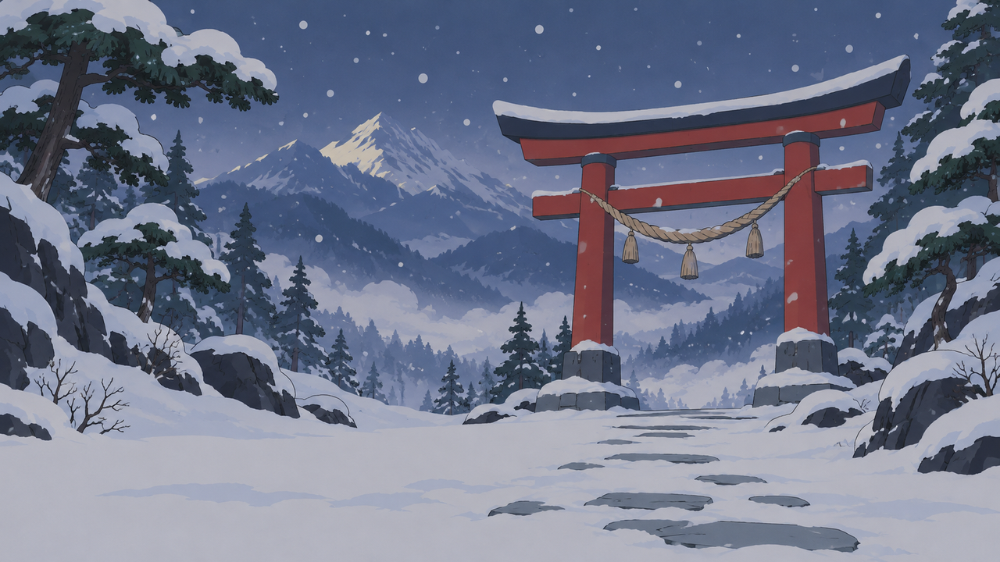
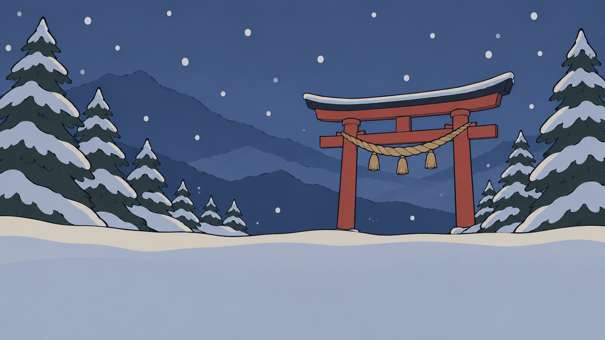
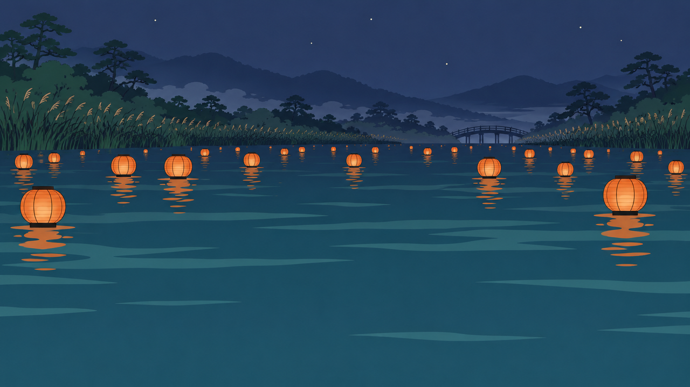
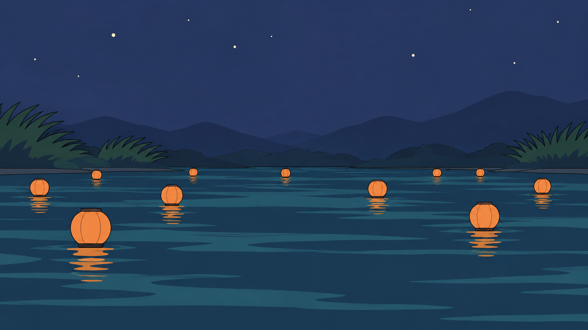
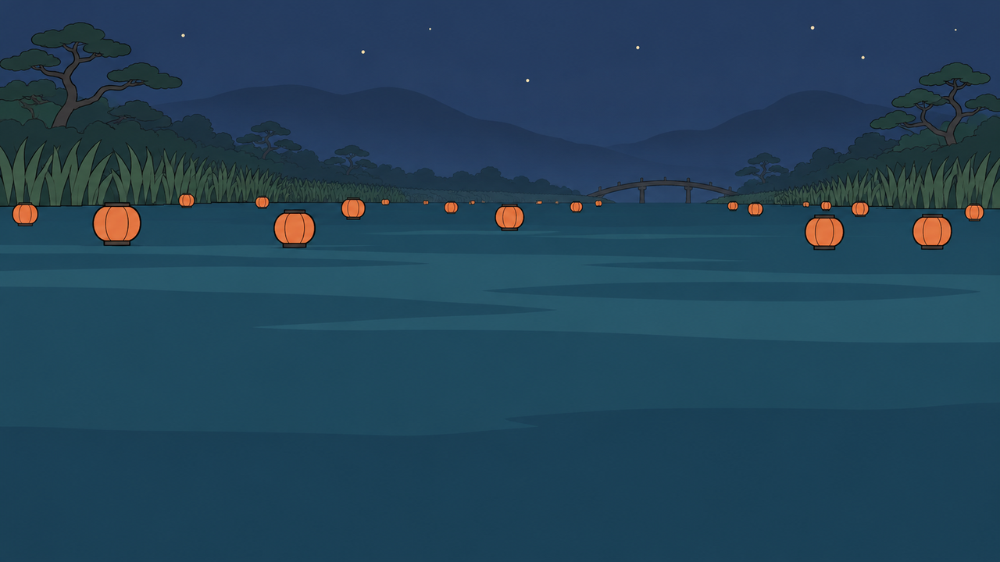
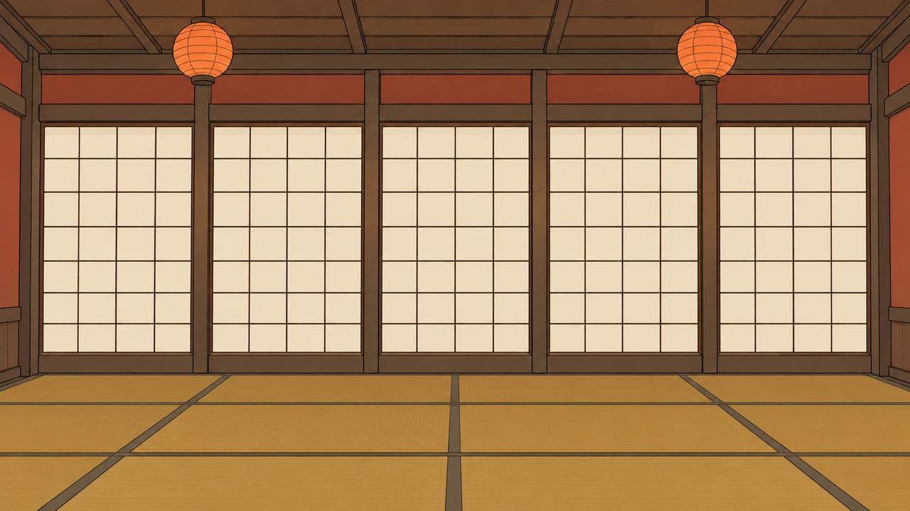

# Trace: visual-real

Command: `visual`. Generator: gpt-6-astra (via `codex exec`). Evaluator: opus (vision). Refiner: sonnet. Target 10/10, at most 3 takes per asset and 9 live takes in all. Refiner prompt: v2, with the keep rule.

The Evaluator sees two images: the accepted bamboo grove backdrop as REFERENCE ([`images/reference-bamboo-grove.png`](images/reference-bamboo-grove.png)), then the take.

| Example | Violation class | Asset slot | Before | After (best take) | Takes |
|---|---|---|---|---|---|
| real-1-oni-shrine-gate | found: Look, Spec form | Stage backdrop S1 for the Oni's stage (YOK-150, assets/specs/stages/snowbound-shrine-gate.md) | 2/10 | 10/10, take 2 | 2 |
| real-2-kappa-riverbank | found: Look | Stage backdrop S1 for the Kappa's stage (YOK-151, assets/specs/stages/lantern-riverbank.md) | 9/10 | 10/10, take 3 | 3 |
| real-3-tanuki-tea-house | found: none | Stage backdrop S1 for the Tanuki's stage (YOK-152, assets/specs/stages/tanuki-tea-house.md) | 10/10 | 10/10, take 1 | 1 |

## real-1-oni-shrine-gate: found: Look, Spec form

**Asset slot** (all the Evaluator and Refiner are told): Stage backdrop S1 for the Oni's stage (YOK-150, assets/specs/stages/snowbound-shrine-gate.md). The Oni's stage: a snowbound mountain shrine gate.

**Prompt given to Astra:** the S1 backdrop prompt from [`assets/specs/stages/snowbound-shrine-gate.md`](../../../../assets/specs/stages/snowbound-shrine-gate.md) word for word, in style.md's style and negative blocks, with the spec's setting `aspect_ratio: 16:9`. No sabotage.

### Take 1: Astra from the stage spec's prompt, 2/10



Prompt: Stylised toon-shaded game art, flat cel colour in 2-3 tone steps, clean confident ink-brush outline of even weight, muted ukiyo-e colour palette, matte surfaces, soft even lighting with no cast shadows, no photographic or painterly texture, no gloss, no baked ambient occlusion, simple readable shapes. Wide stage backdrop, a snowbound mountain shrine gate at blue dusk seen from a low flat viewpoint, a large shrine-red gate standing in the centre-right distance with a thick straw rope across it, snow-laden dark pine trees on both sides, layered indigo mountain ridges fading into pale mist, soft large snowflakes in the air, a faint stone path buried in snow, empty and uncluttered in the lower third, no characters, no text, full-bleed to the image edges with no border or frame. Flat cel colours, soft ink-brush edges. Palette: indigo #2D3A5E, rice paper #F1E8D4, snow shade #A9B4C8, shrine red #B5332B, pine #34483B. Avoid: photorealism, PBR detail, metallic sheen, painterly brush noise, film grain, text, watermark, logo, signature, extra limbs, extra fingers, held props or effects not in the reference, glowing particles, cast shadows, busy background, any resemblance to an existing franchise, artist or character.

Measured by code: 1280x720, on-palette 90%, flatness 35%, lower third edge 23.6 vs upper 25.6, neon 0.0%. Flags: none.

Evaluator's reply:

```
SCORE: 2/10
REASON: [L3] painterly anime-background render: soft gradient mist and cloud banks in the valley, fine-textured rocks and layered pine foliage across the frame (flatness only 35%) (-3)
[L4] far more detail than the bamboo grove reference: dense pine stands, many mountain ridges, cloud layers and twig clusters, where the reference uses simple flat shapes (-1)
[L4] outline weight unlike the reference: thin, broken and uneven linework on the rocks, trees and torii instead of an even ink-brush outline (-1)
[S4] busy lower third: dark stepping stones on pale snow make a high-contrast path down the centre of the fighter band, and rocks and shrubs crowd it (edge strength 23.6 against 25.6 above, barely calmer) (-3)
```

### Take 2: Astra from the Refiner's prompt, 10/10



Prompt: Stylised toon-shaded game art, flat cel colour in 2-3 tone steps, clean confident ink-brush outline of even weight, muted ukiyo-e colour palette, matte surfaces, soft even lighting with no cast shadows, no photographic or painterly texture, no gloss, no baked ambient occlusion, simple readable shapes. Wide 16:9 stage backdrop, full-bleed to all four image edges with no border, frame, letterbox or vignette, of a snowbound mountain shrine gate at blue dusk seen from a low flat viewpoint. A large shrine-red gate stands in the centre-right distance with a thick straw rope across it, drawn as simple flat shapes. Snow-laden dark pine trees stand on both sides, each pine a few bold flat tiers of pine green with snow shade caps, with no individual needles, twigs or foliage clusters. Behind them sit three simple layered indigo mountain ridges, each one a single flat shape with a clean edge, fading into a flat pale band of snow shade sky rather than soft gradient mist, with no cloud banks or valley haze. A few large flat snowflakes drift in the upper two thirds. Every surface uses flat cel colour in 2-3 tone steps with no gradients, and the whole image has a clean, even-weight, confident ink-brush outline in ink #1D1B21, drawn as continuous unbroken lines of the same thickness on the gate, pines, ridges and snow banks, matching the simple flat shapes of the bamboo grove reference. All detail sits in the upper two thirds and at the left and right edges. The lower third is a calm, empty, low-contrast band of smooth snow in snow shade #A9B4C8 and rice paper #F1E8D4, with no path, stepping stones, rocks, shrubs or other objects, only a soft flat tonal shift and a single plain gentle snow bank edge. No characters, no animals, no text. Palette: indigo #2D3A5E, rice paper #F1E8D4, snow shade #A9B4C8, shrine red #B5332B, pine #34483B, ink #1D1B21. Avoid: photorealism, PBR detail, metallic sheen, painterly brush noise, film grain, text, watermark, logo, signature, extra limbs, extra fingers, held props or effects not in the reference, glowing particles, cast shadows, busy background, any resemblance to an existing franchise, artist or character.

Measured by code: 1280x720, on-palette 100%, flatness 47%, lower third edge 11.4 vs upper 21.2, neon 0.0%. Flags: none.

Evaluator's reply:

```
SCORE: 10/10
REASON: Look: the image uses flat cel colour in 2-3 tone steps on the pines, gate and ridges, with a clean even ink outline. Surfaces are matte, with no cast shadows, bloom or glow; the falling snow is flat discs, not glowing particles. There is no grain or painterly texture (flatness 47%), and the outline weight and level of detail match or are simpler than the bamboo grove REFERENCE (L1-L4). Palette and lore: every pixel is within distance 20 of a palette colour, with indigo sky and ridges, ink pines, snow-shade snow (0% pure white), a shrine-red gate and brass bells, and 0% neon. It shows the Oni's snowbound mountain shrine gate at blue dusk, with a straw rope, snow-laden pines and indigo ridges, and nothing modern or horror (P1-P4). Spec form: the image is 1280x720 (16:9) and full-bleed. The top 24 px are plain sky and the bottom 189 px are the empty snowfield, not a border or letterbox. There are no figures or text, and the lower third is calm open snow (edge strength 11.4 against 21.2 above) (S1-S4).
```

**Result:** 2/10 → 10/10 (take 2, the best of 2).

## real-2-kappa-riverbank: found: Look

**Asset slot** (all the Evaluator and Refiner are told): Stage backdrop S1 for the Kappa's stage (YOK-151, assets/specs/stages/lantern-riverbank.md). The Kappa's stage: a riverbank of floating lanterns.

**Prompt given to Astra:** the S1 backdrop prompt from [`assets/specs/stages/lantern-riverbank.md`](../../../../assets/specs/stages/lantern-riverbank.md) word for word, in style.md's style and negative blocks, with the spec's setting `aspect_ratio: 16:9`. No sabotage.

### Take 1: Astra from the stage spec's prompt, 9/10



Prompt: Stylised toon-shaded game art, flat cel colour in 2-3 tone steps, clean confident ink-brush outline of even weight, muted ukiyo-e colour palette, matte surfaces, soft even lighting with no cast shadows, no photographic or painterly texture, no gloss, no baked ambient occlusion, simple readable shapes. Wide stage backdrop, a calm river at night seen from a low flat viewpoint, dozens of small round paper lanterns glowing persimmon orange drifting on dark indigo water in layered depth, a far bank of pine-green reeds and low hills fading into indigo mist, a small arched wooden footbridge far in the distance, a few rice-paper-lit stars, empty and uncluttered in the lower third, no characters, no text, full-bleed to the image edges with no border or frame. Flat cel colours, soft ink-brush edges, water as flat bands. Palette: indigo #2D3A5E, persimmon #D8632C, water teal #3E7F86, pine #34483B, rice paper #F1E8D4. Avoid: photorealism, PBR detail, metallic sheen, painterly brush noise, film grain, text, watermark, logo, signature, extra limbs, extra fingers, held props or effects not in the reference, glowing particles, cast shadows, busy background, any resemblance to an existing franchise, artist or character.

Measured by code: 1280x720, on-palette 100%, flatness 43%, lower third edge 5.5 vs upper 13.9, neon 0.6%. Flags: none.

Evaluator's reply:

```
SCORE: 9/10
REASON: [L4] The upper band has more fine detail than the bamboo grove REFERENCE: dense individually drawn reed stalks along both banks, many small pine clumps, a distant arched bridge and dozens of tiny far lanterns. The flat cel look, palette, Kappa night-river lore (indigo night, lanterns on dark water, reeds), full-bleed 16:9 frame, absence of figures and text, and calm lower third all pass (-1).
```

### Take 2: Astra from the Refiner's prompt, 7/10



Prompt: Stylised toon-shaded game art, flat cel colour in 2-3 tone steps, clean confident ink-brush outline of even weight, muted ukiyo-e colour palette, matte surfaces, soft even lighting with no cast shadows, no photographic or painterly texture, no gloss, no baked ambient occlusion, simple readable shapes. Wide 16:9 stage backdrop, a calm river at night seen from a low flat viewpoint, about a dozen small round paper lanterns glowing flat persimmon orange drifting on dark indigo water in layered depth, each a simple flat orange shape with a clean ink outline, a far bank with a few large simple reed clumps drawn as bold flat shapes in pine green and a low line of hills fading into flat indigo bands, a few rice-paper-lit stars, with the upper two thirds kept sparse and simple in the same low level of detail as a bamboo grove backdrop: no individually drawn reed stalks, no dense foliage, no tiny far lanterns, no bridge. The lower third is empty, calm and uncluttered water in flat low-contrast indigo bands. No characters, no text, full-bleed to the image edges with no border or frame. Flat cel colours, even-weight ink-brush outlines, water as flat bands. Palette: indigo #2D3A5E, persimmon #D8632C, water teal #3E7F86, pine #34483B, rice paper #F1E8D4. Avoid: photorealism, PBR detail, metallic sheen, painterly brush noise, film grain, text, watermark, logo, signature, extra limbs, extra fingers, held props or effects not in the reference, glowing particles, cast shadows, busy background, any resemblance to an existing franchise, artist or character.

Measured by code: 1280x720, on-palette 100%, flatness 56%, lower third edge 11.2 vs upper 7.9, neon 0.0%. Flags: none.

Evaluator's reply:

```
SCORE: 7/10
REASON: [S4] The lower third is not calm. The largest lanterns, with their bright orange reflections (bottom left and bottom right), sit in the fighters' standing band along with high-contrast ripple bands across the water. The measured edge strength there is 11.2 against 7.9 above, so the lower third is busier than the upper two thirds instead of calmer (-3).
```

### Take 3: Astra from the Refiner's prompt, 10/10



Prompt: Stylised toon-shaded game art, flat cel colour in 2-3 tone steps, clean confident ink-brush outline of even weight, muted ukiyo-e colour palette, matte surfaces, soft even lighting with no cast shadows, no photographic or painterly texture, no gloss, no baked ambient occlusion, simple readable shapes. Wide 16:9 stage backdrop, a calm river at night seen from a low flat viewpoint, dozens of small round paper lanterns glowing persimmon orange drifting on dark indigo water in layered depth, a far bank of pine-green reeds and low hills fading into indigo mist, a small arched wooden footbridge far in the distance, a few rice-paper-lit stars. Keep the upper two thirds at the same low level of detail as a bamboo grove backdrop: the reeds are drawn as a few bold flat clumps rather than individual stalks, the pines are a few large simple flat shapes rather than many small clumps, the bridge is one simple flat arch, and the distant lanterns are fewer and larger, each a plain flat orange shape with a clean even-weight ink outline, placed in the upper two thirds of the water and along the edges. The lower third is empty, calm water in flat low-contrast indigo bands, with no lanterns, no bright reflections and no ripples. No characters, no text, full-bleed to the image edges with no border or frame. Flat cel colours, even-weight ink-brush outlines, water as flat bands. Palette: indigo #2D3A5E, persimmon #D8632C, water teal #3E7F86, pine #34483B, rice paper #F1E8D4. Avoid: photorealism, PBR detail, metallic sheen, painterly brush noise, film grain, text, watermark, logo, signature, extra limbs, extra fingers, held props or effects not in the reference, glowing particles, cast shadows, busy background, any resemblance to an existing franchise, artist or character.

Measured by code: 1280x720, on-palette 100%, flatness 62%, lower third edge 2.5 vs upper 8.0, neon 0.0%. Flags: none.

Evaluator's reply:

```
SCORE: 10/10
REASON: Look: flat cel colour in 2-3 tone steps (flatness 62%). Outlines are clean, thin and even, matching the reference's weight and level of detail. The lanterns are flat orange fills with no bloom, the stars are small flat dots rather than glowing particles, and there are no cast shadows, gloss, grain or painterly texture (L1-L4). Palette and lore: 100% of pixels sit within distance 20 of the palette, mainly indigo/ink night tones, persimmon lanterns, pine reeds and trees, with 0% neon and 0% pure white (P1). The scene is the Kappa's river at deep indigo night: paper lanterns drift on dark water among reeds, with a rural wooden bridge, pines and indigo ridges. There are no modern objects and no horror, and the mood is quiet, lantern-lit and a little lonely (P2-P4). Spec form: the image is 1280x720 (16:9) and full-bleed. The 289px bottom flat band is the calm water surface, not a letterbox, and the 34px top band is open sky (S1). There are no characters or figures (S2) and no text (S3). The lower third is empty, low-contrast water (edge strength 2.5 vs 8.0 above), with detail kept in the upper band and the edges (S4).
```

**Result:** 9/10 → 10/10 (take 3, the best of 3).

## real-3-tanuki-tea-house: found: none

**Asset slot** (all the Evaluator and Refiner are told): Stage backdrop S1 for the Tanuki's stage (YOK-152, assets/specs/stages/tanuki-tea-house.md). The Tanuki's stage: the inside of its tea house.

**Prompt given to Astra:** the S1 backdrop prompt from [`assets/specs/stages/tanuki-tea-house.md`](../../../../assets/specs/stages/tanuki-tea-house.md) word for word, in style.md's style and negative blocks, with the spec's setting `aspect_ratio: 16:9`. No sabotage.

### Take 1: Astra from the stage spec's prompt, 10/10



Prompt: Stylised toon-shaded game art, flat cel colour in 2-3 tone steps, clean confident ink-brush outline of even weight, muted ukiyo-e colour palette, matte surfaces, soft even lighting with no cast shadows, no photographic or painterly texture, no gloss, no baked ambient occlusion, simple readable shapes. Wide stage backdrop, the interior of a warm Japanese tea house seen from a low flat viewpoint, dark wooden beams and posts, a long back wall made of five tall shoji screens with blank rice-paper panels evenly spaced (panels completely empty and plain pale paper, no drawing on them), a low wooden ceiling with two hanging paper lanterns glowing persimmon, tatami floor visible in the lower third, empty and uncluttered in the lower third, no characters, no text, full-bleed to the image edges with no border or frame. Flat cel colours, soft ink-brush edges. Palette: rice paper #F1E8D4, straw #B08A48, brown #6E5A48, persimmon #D8632C, shrine red #B5332B. Avoid: photorealism, PBR detail, metallic sheen, painterly brush noise, film grain, text, watermark, logo, signature, extra limbs, extra fingers, held props or effects not in the reference, glowing particles, cast shadows, busy background, any resemblance to an existing franchise, artist or character.

Measured by code: 1280x720, on-palette 100%, flatness 41%, lower third edge 23.2 vs upper 38.3, neon 0.1%. Flags: none.

Evaluator's reply:

```
SCORE: 10/10
REASON: Look: flat cel colour in a few tone steps with clean, even dark-brown outlines and simple, readable shapes (beams, screen grids, tatami seams). It is matte and evenly lit, with no cast shadows, gloss or bloom. The lanterns are flat orange fills, and the outline weight and level of detail match the bamboo grove reference (L1-L4). Palette and lore: every pixel is within distance 20 of a palette colour (wood, brass, rice paper, straw), with no neon or pure white. The scene is the Tanuki's lamplit tea house: wooden beams, tatami, a row of tall blank paper screens and paper lanterns. It has no modern objects, horror or spring colour out of place, and the mood is quiet and a little lonely (P1-P4). Spec form: the image is 1280x720 (16:9) and full-bleed, with zero flat bands at the edges. It has no characters or figures, no text or signature, and the screens are blank. The lower third is an empty tatami floor, calmer than the upper two thirds (edge strength 23.2 vs 38.3) (S1-S4).
```

**Result:** 10/10 → 10/10 (take 1, the best of 1).
