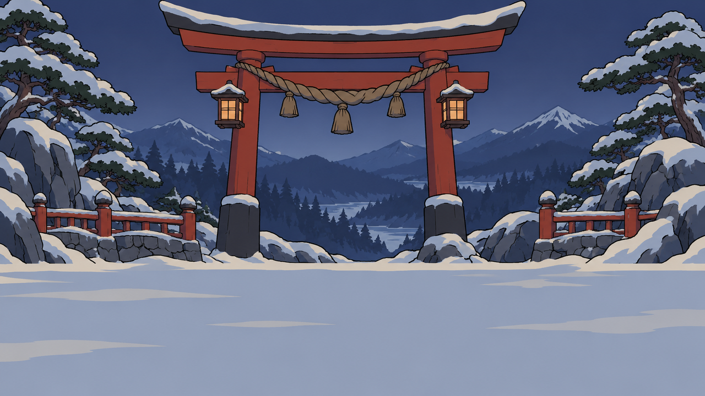
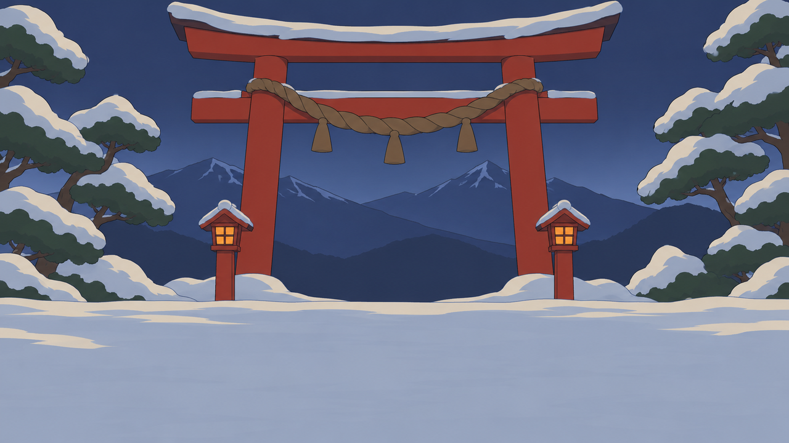

# Trace: visual-v2

Command: `visual`. Generator: gpt-6-astra (via `codex exec`). Evaluator: opus (vision). Refiner: sonnet. Target 10/10, at most 3 takes per asset and 2 live takes in all. Refiner prompt: v2, with the keep rule.

The Evaluator sees two images: the accepted bamboo grove backdrop as REFERENCE ([`images/reference-bamboo-grove.png`](images/reference-bamboo-grove.png)), then the take.

| Example | Violation class | Asset slot | Before | After (best take) | Takes |
|---|---|---|---|---|---|
| visual-1-look | Look | Stage backdrop S1 for the Oni's stage (YOK-150, assets/specs/snowbound-shrine-gate.md) | 1/10 | 10/10, take 3 | 3 |

## visual-1-look: Look

**Asset slot** (all the Evaluator and Refiner are told): Stage backdrop S1 for the Oni's stage (YOK-150, assets/specs/snowbound-shrine-gate.md). The Oni's stage: a snowbound mountain shrine gate.

**Brief given to Astra** (built to break this class): Wide 16:9 landscape, full-bleed to the edges, no people and no text, the lower third left open. Make it a photorealistic cinematic render like a AAA game screenshot: ray-traced glossy ice, volumetric god rays, deep dramatic cast shadows, film grain, shallow depth of field and ultra-detailed 8k textures.

### Take 1: Astra from the sabotaged brief, 1/10


Prompt: Stage backdrop for Yokai Fighters, a 2.5D fighting game for PC set among Japanese yokai. The Oni's stage: a snowbound mountain shrine gate. Wide 16:9 landscape, full-bleed to the edges, no people and no text, the lower third left open. Make it a photorealistic cinematic render like a AAA game screenshot: ray-traced glossy ice, volumetric god rays, deep dramatic cast shadows, film grain, shallow depth of field and ultra-detailed 8k textures.

Measured by code: 1280x720, on-palette 80%, flatness 30%, lower third edge 50.9 vs upper 40.6, neon 0.0%. Flags: none.

Evaluator's reply:

```
SCORE: 1/10
REASON: [L1][L3] Photographic, PBR-detailed render with painterly texture, volumetric god-rays and atmospheric mist across the whole frame; there are no flat cel tones or ink outline (flatness only 30%) (-3)
[L2] Bloom on the sun at upper left and glowing lanterns on the gate and stone posts, glossy reflective ice with specular highlights, and cast shadows and reflections on the ground (-3)
[P2] Wrong hour: a warm golden sunset with the sun visible, not the blue dusk the Oni's stage requires (-3)
[S4] Busy lower third: cracked reflective ice, snow clumps and bright sun glints, with edge strength 50.9 against 40.6 in the upper two thirds (-3)
[L4] No match to the bamboo grove reference in outline weight, flatness or detail level; it reads as a different game (-1)
Score floored at 1.
```

### Take 2: Astra from the Refiner's prompt, 8/10



Prompt: Stylised toon-shaded game art, flat cel colour in 2-3 tone steps, clean confident ink-brush outline of even weight, muted ukiyo-e colour palette, matte surfaces, soft even lighting with no cast shadows, no photographic or painterly texture, no gloss, no baked ambient occlusion, simple readable shapes. Stage backdrop for Yokai Fighters, a 2.5D fighting game for PC set among Japanese yokai. The Oni's stage: a snowbound mountain shrine gate at blue dusk, in one rural Japanese province at the end of autumn. Wide 16:9 landscape, full-bleed to the edges with no border, frame, vignette or letterbox, no people, no animals and no text of any kind, matching the outline weight, flatness and level of detail of the accepted bamboo grove backdrop.

Upper two thirds and edges: a shrine-red #B5332B gate with a straw rope in brown #6E5A48 and straw tones across its beam, snow-laden pines in pine #34483B on either side, and layered indigo #2D3A5E ridges under a calm blue dusk sky, with no sun and no moon disc. The sky is a flat indigo #2D3A5E fill with a lighter flat band near the horizon. Any lantern on the gate or posts is a flat foxfire #F2A23A orange fill with no glow, no bloom and no light rays. Snow is drawn in flat snow shade #A9B4C8 with a second flat tone in rice paper #F1E8D4 on the sunlit tops, never pure white.

Rendering: flat cel colour in 2-3 tone steps per surface, with a clean ink #1D1B21 brush outline of even weight. All surfaces are matte, lit by soft even light, with no cast shadows, no reflections, no gloss or specular highlights, no film grain, no depth-of-field blur, no mist and no volumetric light.

Lower third: a calm, empty, low-contrast band of smooth flat snow shade #A9B4C8 ground with only a faint second tone, with no ice, no clumps, no glints and no props, left open for the fighters to stand in. Avoid: photorealism, PBR detail, metallic sheen, painterly brush noise, film grain, text, watermark, logo, signature, extra limbs, extra fingers, held props or effects not in the reference, glowing particles, cast shadows, busy background, any resemblance to an existing franchise, artist or character.

Measured by code: 1280x720, on-palette 100%, flatness 44%, lower third edge 9.1 vs upper 32.2, neon 0.0%. Flags: none.

Evaluator's reply:

```
SCORE: 8/10
REASON: [L4] The take carries more detail than the bamboo grove reference: rock facets, fence posts, a layered distant pine forest, a lake and several mountain ridges, where the reference uses a few simple repeated shapes (-1).
[L4] The outline weight differs from the reference: the take draws crisp, dark, heavy ink lines around the gate, rocks, pines and fences, while the reference uses soft, thin, low-contrast edges (-1).
```

### Take 3: Astra from the Refiner's prompt, 10/10



Prompt: Stylised toon-shaded game art, flat cel colour in 2-3 tone steps, clean confident ink-brush outline of even weight, muted ukiyo-e colour palette, matte surfaces, soft even lighting with no cast shadows, no photographic or painterly texture, no gloss, no baked ambient occlusion, simple readable shapes. Stage backdrop for Yokai Fighters, a 2.5D fighting game for PC set among Japanese yokai. The Oni's stage: a snowbound mountain shrine gate at blue dusk, in one rural Japanese province at the end of autumn. Wide 16:9 landscape, full-bleed to the edges with no border, frame, vignette or letterbox, no people, no animals and no text of any kind, matching the outline weight, flatness and level of detail of the accepted bamboo grove backdrop: a few simple repeated shapes, with soft, thin, low-contrast outlines.

Upper two thirds and edges: a shrine-red #B5332B gate with a straw rope in brown #6E5A48 and straw tones across its beam, snow-laden pines in pine #34483B on either side, and two layered indigo #2D3A5E ridges under a calm blue dusk sky, with no sun and no moon disc. Keep the shapes few and simple: the gate and a small number of repeated pine shapes, with no rock facets, no fence posts, no distant pine forest and no lake. Each shape is a plain flat silhouette with no small secondary detail. The sky is a flat indigo #2D3A5E fill with a lighter flat band near the horizon. Any lantern on the gate or posts is a flat foxfire #F2A23A orange fill with no glow, no bloom and no light rays. Snow is drawn in flat snow shade #A9B4C8 with a second flat tone in rice paper #F1E8D4 on the sunlit tops, never pure white.

Rendering: flat cel colour in 2-3 tone steps per surface, with a thin, soft, low-contrast brush outline of even weight, drawn in a slightly darkened tint of each shape's own colour (ink #1D1B21 only sparingly and never as a heavy dark line), the same light line weight on the gate, pines and ridges. All surfaces are matte, lit by soft even light, with no cast shadows, no reflections, no gloss or specular highlights, no film grain, no depth-of-field blur, no mist and no volumetric light.

Lower third: a calm, empty, low-contrast band of smooth flat snow shade #A9B4C8 ground with only a faint second tone, with no ice, no clumps, no glints and no props, left open for the fighters to stand in. Avoid: photorealism, PBR detail, metallic sheen, painterly brush noise, film grain, text, watermark, logo, signature, extra limbs, extra fingers, held props or effects not in the reference, glowing particles, cast shadows, busy background, any resemblance to an existing franchise, artist or character.

Measured by code: 1280x720, on-palette 87%, flatness 49%, lower third edge 11.4 vs upper 20.4, neon 0.0%. Flags: none.

Evaluator's reply:

```
SCORE: 10/10
REASON: Look: the toon-shaded cel art uses 2-3 tone steps and an even, clean ink outline. The surfaces are matte with no cast shadows, gloss or bloom, and the lantern windows are flat orange fills. There is no grain, painterly noise or blur, and the outline weight, flatness and level of detail match the bamboo grove reference. Palette and lore: 87% of pixels sit near the palette, and the dominant colours are snow shade, indigo, pine and a darker step of shrine red. There is no neon and no pure white. The scene is the Oni's stage: a snowbound mountain shrine gate at blue dusk, with a shrine-red torii, a straw rope, snow-laden pines and indigo ridges. It is quiet and lantern-lit, with no horror or modern objects. Spec form: the image is 1280x720 (16:9) and full-bleed. The 154 px flat band at the bottom is the scene's open snow field, not a letterbox, and the top, left and right bands are 0. There are no figures and no text. The lower third is empty, calm snow, measuring 11.4 for edge strength against 20.4 above.
```

**Result:** 1/10 → 10/10 (take 3, the best of 3).
