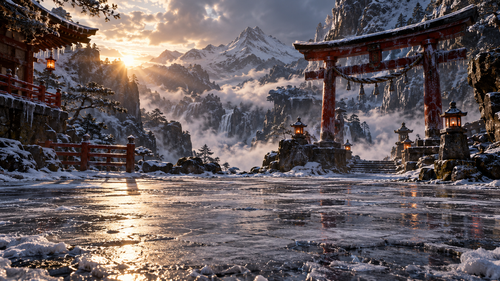
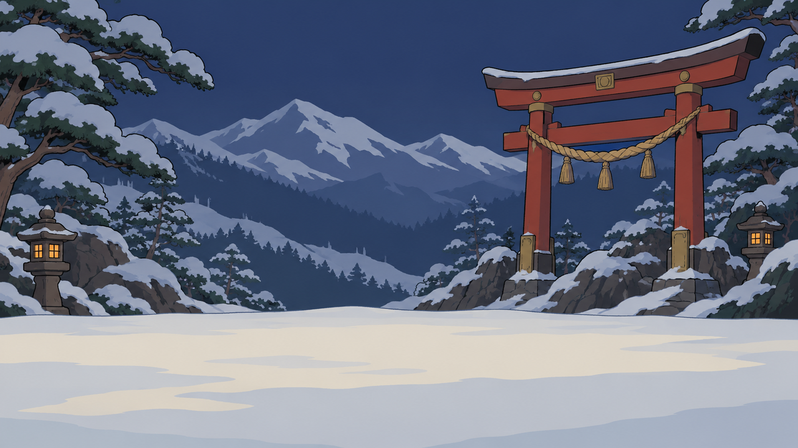
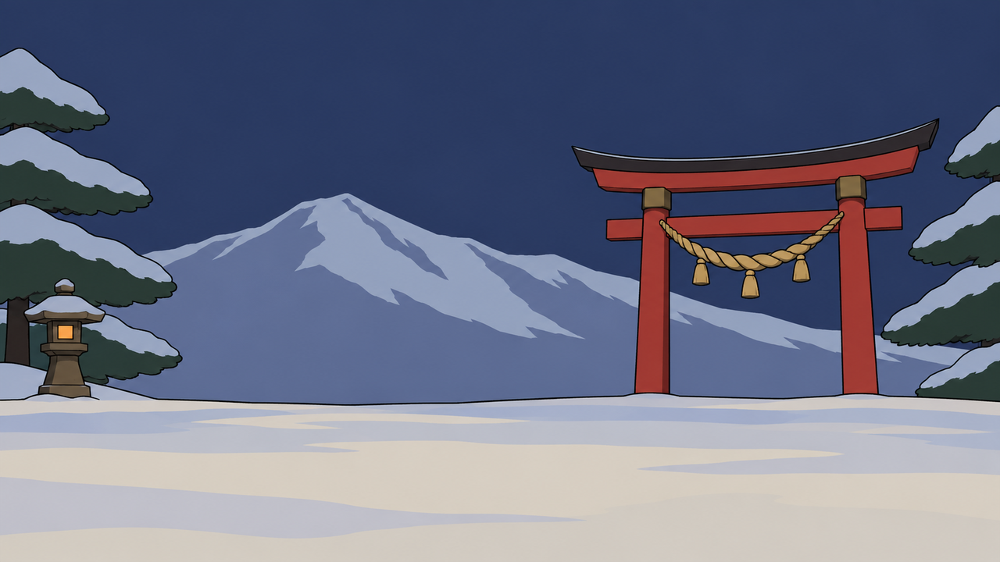
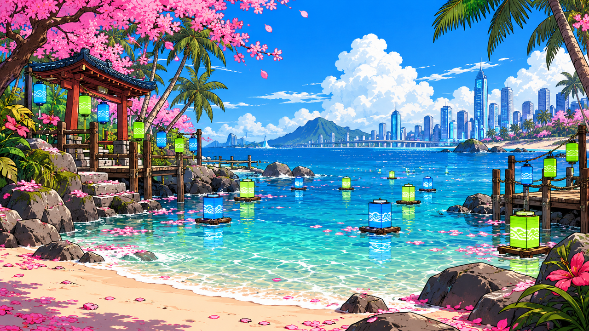
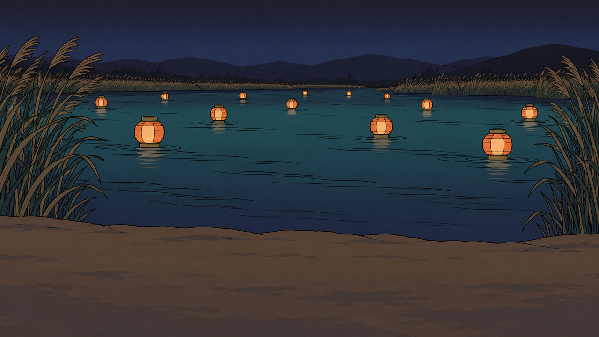
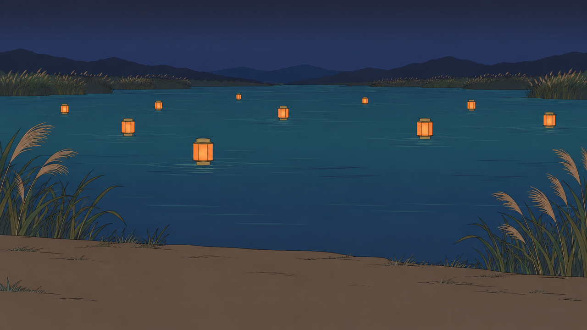
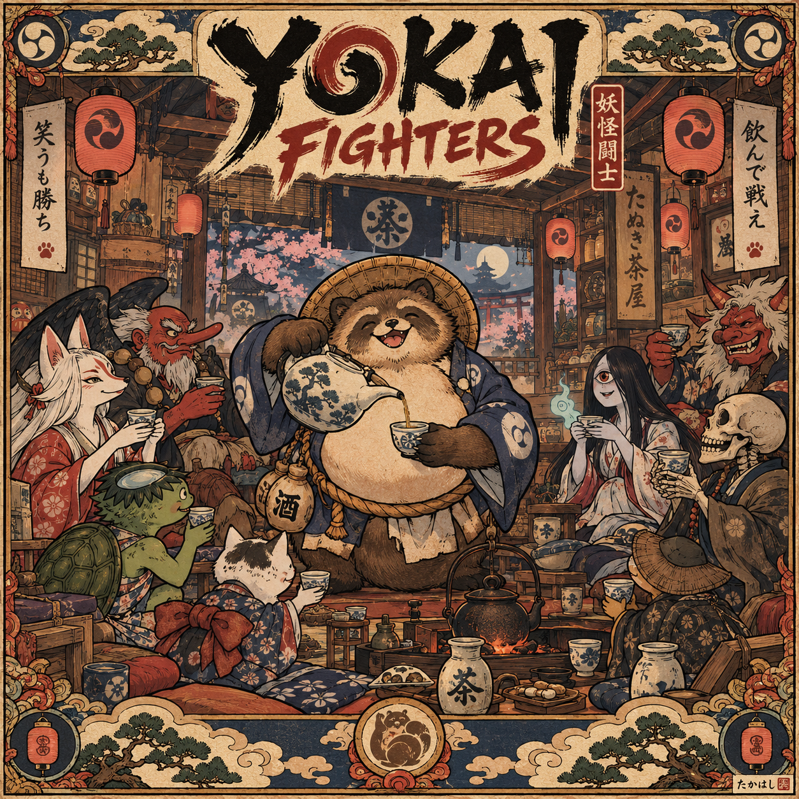
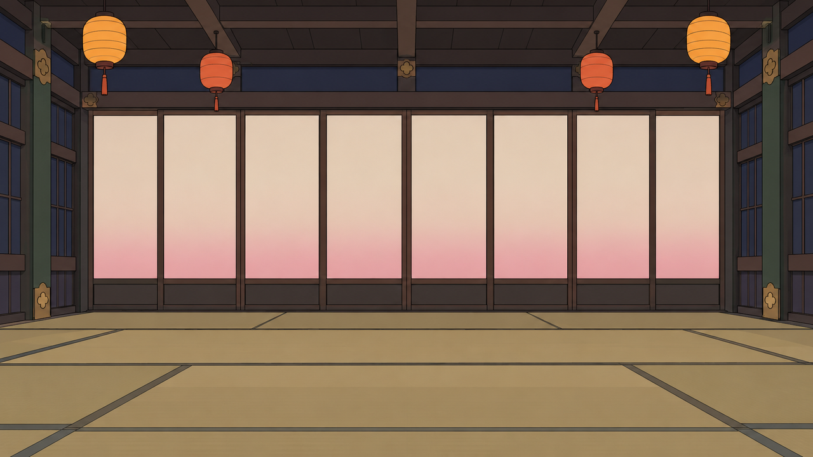
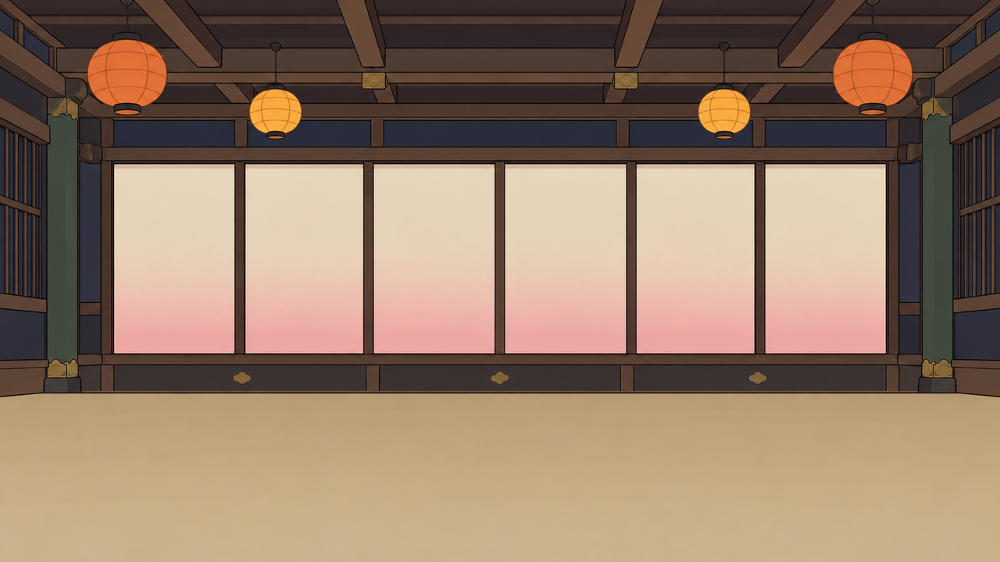

# Trace: visual

Command: `visual`. Generator: gpt-6-astra (via `codex exec`). Evaluator: opus (vision). Refiner: sonnet. Target 10/10, at most 3 takes per asset and 9 live takes in all. Refiner prompt: v1, no keep rule.

The Evaluator sees two images: the accepted bamboo grove backdrop as REFERENCE ([`images/reference-bamboo-grove.png`](images/reference-bamboo-grove.png)), then the take.

| Example | Violation class | Asset slot | Before | After (best take) | Takes |
|---|---|---|---|---|---|
| visual-1-look | Look | Stage backdrop S1 for the Oni's stage (YOK-150, assets/specs/snowbound-shrine-gate.md) | 1/10 | 9/10, take 2 (target not reached: take cap) | 3 |
| visual-2-palette-lore | Palette and lore | Stage backdrop S1 for the Kappa's stage (YOK-151, assets/specs/lantern-riverbank.md) | 1/10 | 8/10, take 2 (target not reached: take cap) | 3 |
| visual-3-spec-form | Spec form | Stage backdrop S1 for the Tanuki's stage (YOK-152, assets/specs/tanuki-tea-house.md) | 1/10 | 10/10, take 3 | 3 |

## visual-1-look: Look

**Asset slot** (all the Evaluator and Refiner are told): Stage backdrop S1 for the Oni's stage (YOK-150, assets/specs/snowbound-shrine-gate.md). The Oni's stage: a snowbound mountain shrine gate.

**Brief given to Astra** (built to break this class): Wide 16:9 landscape, full-bleed to the edges, no people and no text, the lower third left open. Make it a photorealistic cinematic render like a AAA game screenshot: ray-traced glossy ice, volumetric god rays, deep dramatic cast shadows, film grain, shallow depth of field and ultra-detailed 8k textures.

### Take 1: Astra from the sabotaged brief, 1/10



Prompt: Stage backdrop for Yokai Fighters, a 2.5D fighting game for PC set among Japanese yokai. The Oni's stage: a snowbound mountain shrine gate. Wide 16:9 landscape, full-bleed to the edges, no people and no text, the lower third left open. Make it a photorealistic cinematic render like a AAA game screenshot: ray-traced glossy ice, volumetric god rays, deep dramatic cast shadows, film grain, shallow depth of field and ultra-detailed 8k textures.

Measured by code: 1280x720, on-palette 80%, flatness 30%, lower third edge 50.9 vs upper 40.6, neon 0.0%. Flags: none.

Evaluator's reply:

```
SCORE: 1/10
REASON: [L1][L3] Photographic, PBR-detailed render with painterly texture, volumetric god-rays and atmospheric mist across the whole frame; there are no flat cel tones or ink outline (flatness only 30%) (-3)
[L2] Bloom on the sun at upper left and glowing lanterns on the gate and stone posts, glossy reflective ice with specular highlights, and cast shadows and reflections on the ground (-3)
[P2] Wrong hour: a warm golden sunset with the sun visible, not the blue dusk the Oni's stage requires (-3)
[S4] Busy lower third: cracked reflective ice, snow clumps and bright sun glints, with edge strength 50.9 against 40.6 in the upper two thirds (-3)
[L4] No match to the bamboo grove reference in outline weight, flatness or detail level; it reads as a different game (-1)
Score floored at 1.
```

### Take 2: Astra from the Refiner's prompt, 9/10



Prompt: Stylised toon-shaded game art, flat cel colour in 2-3 tone steps, clean confident ink-brush outline of even weight, muted ukiyo-e colour palette, matte surfaces, soft even lighting with no cast shadows, no photographic or painterly texture, no gloss, no baked ambient occlusion, simple readable shapes. Stage backdrop for the Oni's stage in Yokai Fighters: a snowbound mountain shrine gate at blue dusk, in one rural Japanese province at the end of autumn. Wide 16:9 landscape, full-bleed to all four edges, with no border, frame, vignette or letterbox. It matches the accepted bamboo grove backdrop in outline weight, flatness and level of detail.

Upper two thirds and the edges hold all the detail. The sky is a flat blue dusk in indigo #2D3A5E, with layered distant mountain ridges in indigo #2D3A5E and snow shade #A9B4C8, each ridge a simple flat shape. At the centre-right stands a shrine-red #B5332B torii-style gate with brass #B08A48 fittings and a straw rope hung across it, drawn in flat cel colour with a clean ink #1D1B21 brush outline of even weight. Snow-laden pines in pine green #34483B frame the left and right edges, their snow caps in snow shade #A9B4C8 with 2-3 flat tone steps, never pure white. One or two small stone lanterns in brown #6E5A48 sit near the edges, each with a flat foxfire #F2A23A orange fill for the lit window, a plain flat shape with no glow, bloom or halo.

Lower third: a calm, empty, low-contrast band of smooth flat snow ground in snow shade #A9B4C8 and rice paper #F1E8D4 with one soft tone step. It has no props, no footprints, no clumps, no ice and no outlines beyond a single quiet horizon line, leaving clear room for the fighters to stand.

All surfaces are matte with soft even lighting, no sun or moon disc, no cast shadows, no reflections, no gloss, no mist, no light rays and no depth-of-field blur. Shapes are simple, with flat colour areas that read clearly at 720p. The mood is quiet, still and a little lonely, never menacing. No people, yokai or animals, and no text, lettering, kanji or signature. Avoid: photorealism, PBR detail, metallic sheen, painterly brush noise, film grain, text, watermark, logo, signature, extra limbs, extra fingers, held props or effects not in the reference, glowing particles, cast shadows, busy background, any resemblance to an existing franchise, artist or character.

Measured by code: 1280x720, on-palette 90%, flatness 41%, lower third edge 14.8 vs upper 26.4, neon 0.0%. Flags: none.

Evaluator's reply:

```
SCORE: 9/10
REASON: [L4] Busier than the bamboo-grove REFERENCE. The snow-clumped pine boughs on both edges, the layered forested ridges and the snow-capped rocks at the gate's base add noticeably more small shapes and line work than the reference's simple flat bamboo stalks (-1).
```

### Take 3: Astra from the Refiner's prompt, 8/10



Prompt: Stylised toon-shaded game art, flat cel colour in 2-3 tone steps, clean confident ink-brush outline of even weight, muted ukiyo-e colour palette, matte surfaces, soft even lighting with no cast shadows, no photographic or painterly texture, no gloss, no baked ambient occlusion, simple readable shapes. Stage backdrop for the Oni's stage in Yokai Fighters: a snowbound mountain shrine gate at blue dusk, in one rural Japanese province at the end of autumn. Wide 16:9 landscape, full-bleed to all four edges, with no border, frame, vignette or letterbox. It matches the accepted bamboo grove backdrop in outline weight, flatness and level of detail: a few large, simple flat shapes with a clean ink #1D1B21 brush outline of even weight, and very few small shapes or extra line work.

Keep the composition sparse. The upper two thirds and the edges hold the only detail, and it is limited to four simple elements. First, the sky is one flat blue dusk fill in indigo #2D3A5E. Second, a single distant mountain ridge, one broad flat shape in snow shade #A9B4C8 with one slightly darker indigo #2D3A5E tone step, with no forest texture, no tree lines and no secondary ridges. Third, at the centre-right stands one shrine-red #B5332B torii-style gate with a straw rope hung across it in a plain straw tone, drawn as large flat shapes with a brass #B08A48 fitting at each pillar top. The gate's base sits directly on the flat snow with no rocks, no snow clumps and no small details around it. Fourth, one large snow-laden pine in pine green #34483B on each of the left and right edges, each drawn as three or four big simple tiered shapes with a single flat snow shade #A9B4C8 cap per tier. There are no individual needles, no clumped boughs, no hanging snow lumps and no extra branches. One small stone lantern in brown #6E5A48 sits near the left edge, with a flat foxfire #F2A23A orange fill for the lit window, a plain flat shape with no glow, bloom or halo.

Lower third: a calm, empty, low-contrast band of smooth flat snow ground in snow shade #A9B4C8 and rice paper #F1E8D4 with one soft tone step. It has no props, no footprints, no clumps, no rocks, no ice and no outlines beyond a single quiet horizon line, leaving clear room for the fighters to stand. The flat snow fills the band edge to edge, right to the bottom of the frame.

All surfaces are matte with soft even lighting, no sun or moon disc, no cast shadows, no reflections, no gloss, no mist, no light rays and no depth-of-field blur. Snow is never pure white. Shapes are simple, with large flat colour areas that read clearly at 720p. The mood is quiet, still and a little lonely, never menacing. No people, yokai or animals, and no text, lettering, kanji or signature. Avoid: photorealism, PBR detail, metallic sheen, painterly brush noise, film grain, text, watermark, logo, signature, extra limbs, extra fingers, held props or effects not in the reference, glowing particles, cast shadows, busy background, any resemblance to an existing franchise, artist or character.

Measured by code: 1280x720, on-palette 86%, flatness 54%, lower third edge 14.2 vs upper 14.2, neon 0.0%. Flags: none.

Evaluator's reply:

```
SCORE: 8/10
REASON: [L4] The torii, lantern and pines carry a heavy, uniform black ink outline, much bolder than the reference's thin dark outlines and outline-free silhouettes (-1)
[S4] The lower third is empty but no calmer than the upper two thirds (measured edge strength 14.2 vs 14.2). The dark horizon line, the bases of the gate, lantern and pines, and the soft streaked snow bands all sit in the fighters' band (-1)
```

**Result:** 1/10 → 9/10 (take 2, the best of 3).

## visual-2-palette-lore: Palette and lore

**Asset slot** (all the Evaluator and Refiner are told): Stage backdrop S1 for the Kappa's stage (YOK-151, assets/specs/lantern-riverbank.md). The Kappa's stage: a riverbank of floating lanterns.

**Brief given to Astra** (built to break this class): Wide 16:9 landscape, full-bleed, nobody in it and no text, in a flat cel-shaded cartoon style with clean ink outlines. Set it on a bright sunny tropical beach at noon in spring: turquoise water, hot-pink cherry blossoms, palm trees, neon lanterns in electric blue and lime green, and a modern city skyline on the horizon.

### Take 1: Astra from the sabotaged brief, 1/10



Prompt: Stage backdrop for Yokai Fighters, a 2.5D fighting game for PC set among Japanese yokai. The Kappa's stage: a riverbank of floating lanterns. Wide 16:9 landscape, full-bleed, nobody in it and no text, in a flat cel-shaded cartoon style with clean ink outlines. Set it on a bright sunny tropical beach at noon in spring: turquoise water, hot-pink cherry blossoms, palm trees, neon lanterns in electric blue and lime green, and a modern city skyline on the horizon.

Measured by code: 1280x720, on-palette 62%, flatness 37%, lower third edge 47.1 vs upper 45.8, neon 19.3%. Flags: none.

Evaluator's reply:

```
SCORE: 1/10
REASON:
[L1] Dense anime-style rendering with many tone steps per surface and fine detail on the rocks, foliage, blossoms and water ripples across the whole frame, not flat 2-3 step cel colour (flatness 37%) (-3)
[L2] Cast palm-frond and rock shadows on the sand at the lower left and lower right, and glowing lanterns with bloom-like reflections on the water in the centre and right (-3)
[L3] Baked rendering with specular sparkle and glossy caustic water in the centre and lower half, and painterly texture on the clouds and rocks (-3)
[L4] Detail level, outline weight and render style far heavier than the flat, simple bamboo grove reference (-1)
[P1] Saturated blue sky (top centre), turquoise water (centre), hot-pink blossoms and petals (top left and across the sand), and neon-green lanterns (centre and right) sit outside the muted ukiyo-e palette (neon share 19.3%) (-3)
[P2] Bright daytime beach under a blue sky, instead of the Kappa's river at deep indigo night with paper lanterns on dark water and reeds (-3)
[P3] Modern city skyline and bridge (top right), tropical palms and hibiscus (corners), and spring cherry blossom throughout, against a rural Japanese province at the end of autumn (-3)
[S4] Busy, high-contrast lower third filled with rocks, lanterns, pier posts, hibiscus and scattered petals (edge strength 47.1 in the lower third against 45.8 above) (-3)
```

### Take 2: Astra from the Refiner's prompt, 8/10



Prompt: Stylised toon-shaded game art, flat cel colour in 2-3 tone steps, clean confident ink-brush outline of even weight, muted ukiyo-e colour palette, matte surfaces, soft even lighting with no cast shadows, no photographic or painterly texture, no gloss, no baked ambient occlusion, simple readable shapes. Wide 16:9 landscape stage backdrop for the Kappa's riverbank, full-bleed to all four edges with no border, frame, vignette or letterbox. The scene is a quiet rural Japanese river at the end of autumn, at deep indigo night. The sky is a flat deep indigo #2D3A5E with a slightly darker band of ink #1D1B21 at the very top. Low, simple ridges in indigo and ink sit along the far horizon. In the upper two thirds, a calm dark river in water teal #3E7F86 shaded down to indigo carries a loose scatter of round paper lanterns drifting on the water. Each lantern is a flat persimmon #D8632C body with a foxfire #F2A23A flat orange fill for its glow, and a thin brass #B08A48 cap and base. The glow is only a flat fill, with no bloom, no halo and no reflection sparkle. Clumps of tall reeds in pine #34483B and brown #6E5A48 rise along the left and right edges and the far bank, drawn as simple flat blade shapes. A few small rice paper #F1E8D4 highlights on the lanterns are the lightest tones. Everything is drawn in flat cel colour of 2-3 tone steps per surface, with a clean ink-brush outline of even weight, simple large shapes and a low level of detail that matches the flat bamboo grove reference. All surfaces are matte, with soft even light and no cast shadows. The water is flat bands of teal and indigo with a few simple ink-line ripple strokes and no caustics, gloss or sparkle. The lower third is a calm, empty, low-contrast band of flat muted dark brown #6E5A48 and indigo riverbank earth and still water, with no lanterns, reeds, rocks or other detail. The palette is limited to indigo, ink, persimmon, foxfire, brass, water teal, pine, brown and rice paper. There are no bright blues, no turquoise, no neon, no hot pink and no pure white. There are no people, yokai or animals, no buildings, no modern objects and no text of any kind. The mood is quiet, lantern-lit and a little lonely. Avoid: photorealism, PBR detail, metallic sheen, painterly brush noise, film grain, text, watermark, logo, signature, extra limbs, extra fingers, held props or effects not in the reference, glowing particles, cast shadows, busy background, any resemblance to an existing franchise, artist or character.

Measured by code: 1280x720, on-palette 100%, flatness 45%, lower third edge 5.5 vs upper 12.5, neon 0.0%. Flags: none.

Evaluator's reply:

```
SCORE: 8/10
REASON: [L4] The outlines are crisp dark ink lines of even weight on the lanterns, reeds, shoreline and water ripples. The reference bamboo grove has much softer, barely visible outlines, so the line weight does not match the accepted stage (-1).
[L2] Each lantern body has a smooth cream-to-orange gradient glowing from its centre, with soft lit reflections below on the water (the larger lanterns at left and centre-right especially). The guide calls for a lantern's glow to be a flat orange fill, so this is a little more gradient than allowed. There is no halo or bloom around them, so it is a soft drift, not a hard break (-1).
```

### Take 3: Astra from the Refiner's prompt, 8/10



Prompt: Stylised toon-shaded game art, flat cel colour in 2-3 tone steps, clean confident ink-brush outline of even weight, muted ukiyo-e colour palette, matte surfaces, soft even lighting with no cast shadows, no photographic or painterly texture, no gloss, no baked ambient occlusion, simple readable shapes. Wide 16:9 landscape stage backdrop for the Kappa's riverbank, full-bleed to all four edges with no border, frame, vignette or letterbox, the artwork running right to the edge of the image on every side. The scene is a quiet rural Japanese river at the end of autumn, at deep indigo night. The sky is a flat deep indigo #2D3A5E with a slightly darker flat band of ink #1D1B21 at the very top. Low, simple ridges in indigo and ink sit along the far horizon. In the upper two thirds, a calm dark river in flat water teal #3E7F86 stepping down to indigo carries a loose scatter of round paper lanterns drifting on the water. Each lantern is a single flat persimmon #D8632C body with one flat foxfire #F2A23A orange fill for its glow, and a thin brass #B08A48 cap and base. The glow is one solid flat colour shape with hard edges: no gradient, no cream-to-orange blend, no lighter centre, no bloom, no halo, no soft light on the water, and no reflections of the lanterns beneath them. Rice paper #F1E8D4 appears only as a few tiny flat accent marks, never as a blended glow. Clumps of tall reeds in pine #34483B and brown #6E5A48 rise along the left and right edges and the far bank, drawn as simple flat blade shapes. Everything is drawn in flat cel colour of 2-3 tone steps per surface, with a soft, thin, understated ink-brush outline of even weight in deep indigo-ink, barely visible and light, matching the delicate, quiet linework of the accepted flat bamboo grove reference rather than bold dark contour lines. Lines on the lanterns, reeds, shoreline and water ripples are all this same thin, subtle weight, and shapes are simple and large with a low level of detail. All surfaces are matte, with soft even light and no cast shadows. The water is flat bands of teal and indigo with only a few very thin, faint ripple strokes and no caustics, gloss, sparkle or reflected light. The lower third is a calm, empty, low-contrast band of flat muted brown #6E5A48 and indigo riverbank earth and still water, with no lanterns, reeds, rocks or other detail. The palette is limited to indigo, ink, persimmon, foxfire, brass, water teal, pine, brown and rice paper. There are no bright blues, no turquoise, no neon, no hot pink and no pure white. There are no people, yokai or animals, no buildings, no modern objects and no text of any kind. The mood is quiet, lantern-lit and a little lonely. Avoid: photorealism, PBR detail, metallic sheen, painterly brush noise, film grain, text, watermark, logo, signature, extra limbs, extra fingers, held props or effects not in the reference, glowing particles, cast shadows, busy background, any resemblance to an existing franchise, artist or character.

Measured by code: 1280x720, on-palette 100%, flatness 44%, lower third edge 7.0 vs upper 6.4, neon 0.0%. Flags: none.

Evaluator's reply:

```
SCORE: 8/10
REASON:
[S4] The lower third is not calmer than the rest: grass tufts scattered across the sand bank, the reed bases at the left and right edges, and water-ripple lines just above the bank push edge strength there to 7.0, above the upper two thirds at 6.4 (-1)
[L4] Slightly more fine detail than the reference: the pampas plumes and reed clumps along both banks are drawn with many thin hairline blades and strands, and the water carries fine ripple hatching, where the bamboo grove uses simpler leaf shapes (-1)
```

**Result:** 1/10 → 8/10 (take 2, the best of 3).

## visual-3-spec-form: Spec form

**Asset slot** (all the Evaluator and Refiner are told): Stage backdrop S1 for the Tanuki's stage (YOK-152, assets/specs/tanuki-tea-house.md). The Tanuki's stage: the inside of its tea house.

**Brief given to Astra** (built to break this class): Flat cel-shaded style with ink outlines and muted ukiyo-e colours. Make it a square poster with an ornate decorative border: the round Tanuki merchant standing in the centre foreground pouring tea, guests kneeling around him, cushions and teacups crowding the floor, and the title YOKAI FIGHTERS in big calligraphy across the top with an artist's signature in the corner.

### Take 1: Astra from the sabotaged brief, 1/10



Prompt: Stage backdrop for Yokai Fighters, a 2.5D fighting game for PC set among Japanese yokai. The Tanuki's stage: the inside of its tea house. Flat cel-shaded style with ink outlines and muted ukiyo-e colours. Make it a square poster with an ornate decorative border: the round Tanuki merchant standing in the centre foreground pouring tea, guests kneeling around him, cushions and teacups crowding the floor, and the title YOKAI FIGHTERS in big calligraphy across the top with an artist's signature in the corner.

Measured by code: 1254x1254, on-palette 100%, flatness 31%, lower third edge 55.2 vs upper 53.3, neon 0.0%. Flags: S1: aspect ratio 1.0 (1254x1254), not 16:9 (1.778); S1: 1254 px wide, under the 1280 px minimum.

Evaluator's reply:

```
SCORE: 1/10
REASON:
[L1] Dense hatched ukiyo-e illustration with variable-weight linework across the whole frame, not flat 2-3 tone cel colour with an even-weight outline (-1)
[L3] Aged-paper grain and gritty texture across the whole frame, a baked painterly/textured render (-3)
[L4] Far more detail than the bamboo grove reference (patterned robes, crockery, shelves, ornate border motifs), so it does not read as the same game (-1)
[P3] Spring cherry blossoms in the window at upper centre, outside the season screens; the world must be late autumn (-3)
[P4] A grinning skeleton with a skull (right) and a menacing fanged red oni (upper right) bring horror imagery (-3)
[S1] Square 1254x1254 image, aspect 1.0, not 16:9 (-3)
[S1] Ornate decorative border and frame with corner crests and cloud-and-pine panels around the whole image, not full-bleed (-3)
[S2] Characters fill the scene: the tanuki, kitsune, tengu, kappa, cat, one-eyed woman, oni, skeleton and a straw-hatted figure (-3)
[S3] Text throughout: the "YOKAI FIGHTERS" title (top), kanji banners and signs (left, right and centre), and a signature seal (bottom right) (-3)
[S4] The lower third is crowded with figures, teaware, a kettle over fire and border ornament, and its edge strength (55.2) is higher than the upper two thirds (53.3) (-3)
```

### Take 2: Astra from the Refiner's prompt, 9/10



Prompt: Stylised toon-shaded game art, flat cel colour in 2-3 tone steps, clean confident ink-brush outline of even weight, muted ukiyo-e colour palette, matte surfaces, soft even lighting with no cast shadows, no photographic or painterly texture, no gloss, no baked ambient occlusion, simple readable shapes. A wide 16:9 landscape stage backdrop, full-bleed to all four edges with no border, frame, vignette, letterbox or rounded corners. The empty inside of the Tanuki's lamplit tea house at late-autumn evening, seen straight on as a calm, quiet room with no people, yokai or animals anywhere. The upper two thirds holds the detail: dark wooden ceiling beams in wood dark and brown #6E5A48 running across the top, a few paper lanterns hung from them as flat foxfire #F2A23A and persimmon #D8632C fills with no glow, and along the back wall a row of tall, blank paper screens in rice paper #F1E8D4 with plain wooden frames. The screens are completely empty, with no drawings, no patterns and no writing. Only the screens carry a soft spring pink #E8A6B0 tint along their lower panels as the season colour. Everywhere else the room stays autumn: indigo #2D3A5E and ink #1D1B21 shadows in the wall panels, a pine #34483B accent on the side posts, and brass #B08A48 for small fittings. No windows with blossoms, no flowers outside the screens, no banners, signs, kanji or letters, no skulls or masks, no kettle or fire. The lower third is a calm, empty, low-contrast band of flat tatami floor in straw tones with one or two quiet tone steps and only faint, thin mat seams, with no cushions, teacups, furniture or ornament, so the fighters can stand there. Every surface is flat matte colour in 2-3 tone steps with a clean ink outline of even weight, simple large shapes, and minimal detail matching a simple bamboo grove backdrop, with no hatching, no paper grain and no texture. The mood is cosy, a little lonely and gently melancholy. Avoid: photorealism, PBR detail, metallic sheen, painterly brush noise, film grain, text, watermark, logo, signature, extra limbs, extra fingers, held props or effects not in the reference, glowing particles, cast shadows, busy background, any resemblance to an existing franchise, artist or character.

Measured by code: 1280x720, on-palette 100%, flatness 40%, lower third edge 23.0 vs upper 18.6, neon 0.0%. Flags: none.

Evaluator's reply:

```
SCORE: 9/10
REASON: [S4] the tatami floor in the lower third has dark seam lines that cross the whole band in perspective, so it is the highest-contrast part of the frame (edge strength 23.0 against 18.6 above) and not as calm as the rule asks. It holds no objects, so it is not cluttered (-1).
```

### Take 3: Astra from the Refiner's prompt, 10/10



Prompt: Stylised toon-shaded game art, flat cel colour in 2-3 tone steps, clean confident ink-brush outline of even weight, muted ukiyo-e colour palette, matte surfaces, soft even lighting with no cast shadows, no photographic or painterly texture, no gloss, no baked ambient occlusion, simple readable shapes. A wide 16:9 landscape stage backdrop, full-bleed to all four edges with no border, frame, vignette, letterbox or rounded corners. The empty inside of the Tanuki's lamplit tea house at late-autumn evening, seen straight on as a calm, quiet room with no people, yokai or animals anywhere. The upper two thirds holds all the detail: dark wooden ceiling beams in wood dark and brown #6E5A48 running across the top, a few paper lanterns hung from them as flat foxfire #F2A23A and persimmon #D8632C fills with no glow, and along the back wall a row of tall, blank paper screens in rice paper #F1E8D4 with plain wooden frames. The screens are completely empty, with no drawings, no patterns and no writing. Only the screens carry a soft spring pink #E8A6B0 tint along their lower panels as the season colour. Everywhere else the room stays autumn: indigo #2D3A5E and ink #1D1B21 in the wall panels, a pine #34483B accent on the side posts, and brass #B08A48 for small fittings. No windows with blossoms, no flowers outside the screens, no banners, signs, kanji or letters, no skulls or masks, no kettle or fire. The lower third is a calm, empty, very low-contrast band of one flat straw-toned tatami floor colour in a single soft tone, with at most one slightly lighter tone step, and no dark lines. It has no mat seams, no edge lines, no perspective grid, no outlines, no shadows, no cushions, teacups, furniture or ornament, so the fighters can stand there. The floor meets the back wall along one single thin ink outline, and that is the only line in the band. The floor colour sits close in value to the wall base above it, so the band reads as quieter than everything above it. Every surface is flat matte colour in 2-3 tone steps with a clean ink outline of even weight, simple large shapes, and minimal detail matching a simple bamboo grove backdrop, with no hatching, no paper grain and no texture. The mood is cosy, a little lonely and gently melancholy. Avoid: photorealism, PBR detail, metallic sheen, painterly brush noise, film grain, text, watermark, logo, signature, extra limbs, extra fingers, held props or effects not in the reference, glowing particles, cast shadows, busy background, any resemblance to an existing franchise, artist or character.

Measured by code: 1280x720, on-palette 100%, flatness 42%, lower third edge 9.9 vs upper 20.2, neon 0.0%. Flags: none.

Evaluator's reply:

```
SCORE: 10/10
REASON: Look [L1-L4]: The take uses flat cel colour in a few tone steps with clean, even, thin ink outlines and simple shapes that read at 720p. It has no cast shadows, gloss, bloom or texture. The lanterns are flat orange and yellow fills with no glow. Flatness and level of detail match the bamboo grove reference, whose sky gradient is comparable to the soft gradient on the screens. Palette and lore [P1-P4]: All pixels fall within distance 20 of the palette (straw, wood dark, ink, rice paper, indigo, pine, foxfire/persimmon lanterns, brass fittings), with 0% neon and 0% pure white. The scene is clearly the Tanuki's lamplit tea house: wooden beams, a straw-toned floor and a row of tall blank paper screens. Spring pink appears only on those season screens. Nothing is modern and nothing reads as horror, and the mood is quiet and lantern-lit. Spec form [S1-S4]: The image is 1280x720 (1.778, 16:9) and full-bleed with no frame or vignette. The 211 px bottom flat band is the empty floor, not a letterbox. There are no characters or figures, the screens are blank, and there is no text. The lower third is the calm, empty floor (edge strength 9.9 against 20.2 above), and detail sits in the upper two thirds and the edges.
```

**Result:** 1/10 → 10/10 (take 3, the best of 3).
